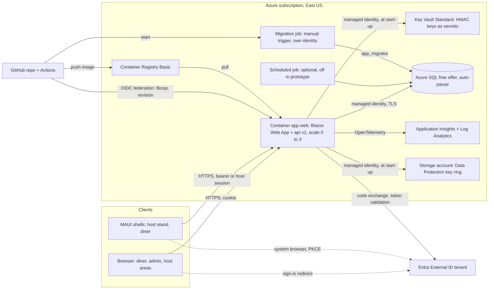
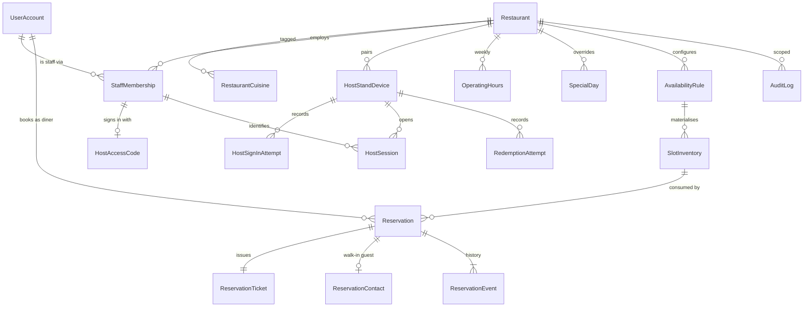

# ARCHITECTURE.md — Table Reservation Software (prototype build instructions)

You are a Claude Code agent. Build the complete prototype described here: a restaurant table reservation service with a diner area, an admin area and a host stand area, on ASP.NET Core / Blazor / Azure SQL, hosted on Azure Container Apps. The result must run end to end locally, pass its test suite, and be deployable to Azure by the pipeline you write.

This file has two parts. **Part A** is how to work: rules, agent setup, build phases, gates, definition of done. **Part B** is the reference specification: every design decision, with its reason. Part B is authoritative for *what* to build; Part A is authoritative for *how and in what order*. Read Part A fully now. Read each Part B section when a phase points you to it, not all at once.

---

# Part A — How to build it

## A1. Outcome

1. `docker compose up` starts the app and a SQL Server container; with the development sign-in handler and local seed data, a person can complete both journeys in a browser: (a) a diner searches, books and sees a ticket with a QR code and 4-digit code; (b) a manager pairs a host device, a host signs in with a 4-digit code and checks the diner in by QR or code.
2. `dotnet test` passes: unit, component, integration, concurrency, authorization matrix, lockout, start-up, and Playwright end-to-end tests (B: Testing strategy).
3. `infra/` (Bicep) and `.github/workflows/` deploy the same image to Azure Container Apps with Azure SQL, Key Vault, Blob Storage and Application Insights, run the migration job, and smoke-test the revision. You write and validate these; a human runs the first deployment (A6).
4. `README.md` and `docs/` tell a human exactly how to run, test, deploy, rehearse the demo and fall back to the local demo.

## A2. Fixed decisions — do not change these

Everything in Part B is decided. In particular, these stay exactly as written:

- Host devices must be paired by a manager, with a one-time code from the manager's own device, before the 4-digit code works (the code alone is too weak).
- A manager cannot remove or demote an owner or grant the owner role, and a restaurant can never be left without an active owner. Otherwise owners and managers have identical privileges, as the planning doc states.
- MFA for the admin app; a redemption time window; a two-step check-in (preview, then confirm).
- Hosts can add walk-in or phone bookings and cancel on a phone request (read as part of "control reservation lists"). No-show is derived from the clock, never tapped.
- Any signed-in admin user can onboard a restaurant and becomes its owner (prototype only).
- The planning doc asks for separate front-end apps; the prototype is one web app with three gated areas (diner, admin, host stand), and separate native shells come later.
- Blazor is chosen over Expo because of the .NET MAUI path to native apps, and that path's spike is in week 4 and first to be cut, so it may be untested at the interview.

Also fixed: .NET 10, EF Core 10, Minimal APIs, modular monolith, one host serving the Blazor Web App and `/api/v1`; Microsoft Entra External ID with cookie BFF for diners and owners/managers; Azure SQL with insert-only reservation tables and event-derived state; HMAC-derived QR reference; atomic booking, redemption and host sign-in SQL exactly as specified; scale to zero with no in-process timers and no database access before a request needs it.

If you believe a decision in Part B cannot work, do not silently replace it. Stop, write the problem and your proposed change to `docs/DECISIONS.md`, and ask the human. The only pre-approved substitutions are the fallbacks Part B names (for example Kiota → NSwag, jsQR → another decoder, External ID → ASP.NET Core Identity with cookies).

## A3. Working rules

- **Scope.** Build every Must and Should item (B: scope tiers). Build Cut-first items only after the definition of done is met, in the order B lists them from the top, and only those that need no Azure access or paid account. Keep every Production item out, but keep its extension point.
- **Read Part B's vocabulary this way.** "The author" is the human owner. "Week 1 spikes" are checks you perform in phase 0 and phase 2 where you can, and otherwise write up as human steps. "Interview" and "demo" mean the human's live demonstration. Where Part B's week plan and Part A's phases differ, Part A governs order.
- **Unverified facts.** Part B marks some facts "(unverified)" and lists them. Before relying on one, check the current official documentation. If it is false or cannot be confirmed, use the fallback Part B names; if none is named, pick the option that keeps the local build working, and record it in `docs/DECISIONS.md`.
- **Versions.** Do not trust package versions from memory or from Part B. Resolve current stable versions that target `net10.0` at build time and pin them centrally (`Directory.Packages.props`).
- **Secrets.** Never commit a secret, key, connection string with credentials, or real tenant id. Local development uses `dotnet user-secrets` or environment variables with obviously fake values; HMAC keys for local runs are generated at first start.
- **No spending, no outside effects without the human.** Do not create Azure resources, tenants, app registrations or DNS records, and do not change GitHub repository settings, secrets or environments. Validate infrastructure with `az bicep build` and lint only. Pushing commits and opening pull requests on the project repository is expected (A9).
- **Tests are the specification's enforcement.** A phase is not done until its gate passes. Never weaken, skip or delete a test to pass a gate; if a test and Part B disagree, Part B wins and the test is fixed.
- **Unit tests are written with the code, not after it.** Every commit that adds or changes logic contains the unit tests for that logic in the same commit. For pure logic (`Domain`: status rules, slot generation, MAC and code derivation, time-zone conversion, lockout arithmetic, validators) write the test first, watch it fail, then write the code. A commit that adds logic without tests is not pushed. The unit-test project must stay fast (no database, no network, no clock: inject `TimeProvider`) so it runs on every commit.
- **Small commits, pushed as you go.** Commit each coherent unit of work (one endpoint, one table group, one screen) with its tests, and push after every commit so the repository always shows current progress. Rules are in A9.
- **Keep state on disk.** Maintain `docs/PROGRESS.md` (phase, status, gate result, open issues) and `docs/DECISIONS.md` (every choice Part B left open and what you chose). Read `PROGRESS.md` first whenever you resume.

## A4. Agent configuration

Use an orchestrator with a small set of single-purpose subagents. Subagents exist to keep context clean and to give independent eyes; they start cold and cost tokens, so do not add more.

Create these as files in `.claude/agents/` (check the current Claude Code documentation for the frontmatter format before writing them) and put the standing rules from A3 in `CLAUDE.md` at the repository root.

| Agent | Tools | Job | Brief it with |
|---|---|---|---|
| **Orchestrator** (the main session) | All | Owns the plan, `PROGRESS.md`, phase briefs, gate runs, commits. Writes no feature code except trivial glue. | This file |
| `implementer` | Read, write, shell | Builds one phase in small commits: production code with its unit tests in the same commit (test first for `Domain` logic), plus the integration tests that phase lists. Runs `scripts/gate.sh unit` before every commit. Returns a summary of files changed and anything it could not do. | The phase entry from A5, the Part B headings it names, the current `PROGRESS.md` |
| `test-author` | Read, write, shell | After the implementer finishes a phase, writes the specification-derived tests for it (authorization matrix rows, concurrency, lockout, immutability, start-up) from Part B alone. It must not change production code; a failing test is reported, not "fixed" by weakening it. | The Part B test requirements for that phase and the public API surface |
| `reviewer` | Read-only, shell for running tests | Fresh context. Reviews the phase's diff against the named Part B sections. Reports blocking / major / minor issues with file and line, and a concrete fix. Does not edit. | The diff range, the Part B headings, the review checklist below |
| `security-reviewer` | Read-only | Same as reviewer, but only for phases 2, 4 and 5 and the final pass, and only on: authentication, authorization and tenant isolation, the three atomic SQL units, secret handling, cookie and CSRF settings, logging of sensitive values. | The diff range and B: Authentication, Authorization, Reservation ticket security, Threat model, Security of stored data |

**Loop for every phase:** orchestrator creates the phase branch and writes the brief → `implementer` builds, committing and pushing as it goes → orchestrator runs the gate → `test-author` adds specification tests → gate again → `reviewer` (and `security-reviewer` where listed) → `implementer` fixes blocking and major issues → gate → push → pull request to `main`, merged when CI is green → update `PROGRESS.md`. At most two review rounds per phase; anything still open goes to `PROGRESS.md` and the final pass.

**Models.** Use the most capable model for the orchestrator, for `implementer` on phases 2, 4 and 5, and for both reviewers. A faster model is acceptable for `implementer` on scaffolding, UI and infrastructure phases.

**Parallelism.** Phases 1 to 6 share the schema and `Domain` and run in sequence. Two things may run in parallel in separate git worktrees, at most two extra agents at a time: phase 9 (infrastructure and pipeline), any time after phase 0; and a phase's UI work (phase 7 items), once that phase's endpoints and OpenAPI document are committed.

**Gate script.** In phase 0 write `scripts/gate.sh`: restore, build with warnings as errors, format check, run the requested test projects, and print only failures and a one-line summary. Modes: `unit` (unit tests only, seconds, run before every commit), `phase <n>` (unit plus that phase's integration and specification tests), `all` (everything including Playwright). CI runs the same script, so local and remote results cannot differ. Every agent runs gates through it so test output never floods a context.

**Review checklist** (give this to `reviewer`): matches the named Part B sections, with no invented behaviour; every raw SQL statement carries `RestaurantId` and `@NowUtc` and reads no database clock; insert-only tables are never updated; no query before a request needs the database; module boundaries respected; errors are RFC 9457 problem details; nothing sensitive is logged; tests assert behaviour, not implementation; no dead code, no TODOs left without a `PROGRESS.md` entry.

## A5. Build phases

Each phase lists what to build, the Part B sections to read, and its gate. "B:" names a heading or a bold paragraph title in Part B; search for the words.

**Phase 0 — Bootstrap.** Connect to the project repository and set up the CI workflow first (A9). Repository layout and solution exactly as in B: Runtime, framework and architecture. `CLAUDE.md`, `.claude/agents/`, `scripts/gate.sh`, `docs/PROGRESS.md`, `docs/DECISIONS.md`. `docker-compose.yml` with SQL Server and the app. Central package management. Architecture test for module boundaries. Health endpoints `/healthz`, `/readyz`. OpenAPI document at `/openapi/v1.json`. Confirm what you can of the spikes: QRCoder renders under WebAssembly; chosen packages target `net10.0`.
*Gate:* build and an empty test run pass in the container; architecture test passes; the first push to the repository shows a green CI run.

**Phase 1 — Domain and schema.** B: Logical data model, Immutability, Multi-tenancy, Security of stored data, Time zones, Operations (migrations). All tables, constraints, filtered unique indexes, temporal tables; raw-SQL migrations for grants, `DENY`, `INSTEAD OF` triggers; roles `app_runtime`, `app_migrator`, `app_support_read`; EF global query filters; the pure `Status` function; `TimeProvider` everywhere; migration bundle; local seeding via `UseAsyncSeeding`.
*Gate:* unit tests for status rules; integration tests showing `UPDATE` and `DELETE` fail on every insert-only table under both identities; the scan test for `SYSUTCDATETIME`/`GETUTCDATE`.

**Phase 2 — Identity, sessions and authorization.** B: Authentication and identity, Authorization, App structure (cookie schemes), Cross-cutting concerns. Development sign-in handler (Development only, behind a flag, with the test that it is absent otherwise). OIDC cookie BFF for External ID behind configuration: `/auth/{diner|admin}/login` and `logout`, `oid`/`tid` keying, `SaveTokens = false`, cookie settings, CSRF header filter, CSP, `SessionsValidFromUtc`, Data Protection to Blob Storage with Key Vault wrapping (local: file system), forwarded headers, the path-based policy scheme. Policies `RestaurantStaff`, `OwnerGuard` (including the last-owner rule), `HostAtRestaurant`, `ReservationOwner`; fallback policy; 404 on cross-tenant access. Membership cache of at most 60 seconds. Rate limiter. Also implement the named fallback (ASP.NET Core Identity with cookies, seeded accounts, no email) behind the same configuration switch.
*Gate:* authorization-matrix harness exists and passes for the endpoints so far; start-up test (no database connection for `/`, `/healthz`, `/readyz`); CSRF tests on `GET` and `POST`. Security review.

**Phase 3 — Restaurants, hours and availability.** B: Core domain logic (availability, slot materialisation), Search and availability queries, API design. Onboarding (`POST /admin/restaurants`, caller becomes owner), hours, special days, availability rules with validation, slot generation and regeneration (set-based capacity statement, close-never-delete, no hours across midnight, DST rule), search by city and name prefix, availability read with lazy materialisation.
*Gate:* unit tests for slot generation including DST days; integration tests for regeneration after hours shrink and for concurrent generators.

**Phase 4 — Booking and tickets.** B: Reservation ticket security, Concurrency and correctness, API design, Secrets and keys (key ids and rotation). Booking transaction exactly as specified, inside the execution strategy, with idempotency lookup first, 201/200, 422 on body mismatch, the 5-upcoming cap, index-name-aware duplicate handling. QR reference `R1.<keyId>.<reservationId>.<mac>`; 4-digit code derivation and `CodeLookupHmac`; key provider with multiple enabled key versions. Diner list, ticket, cancel. Account erasure.
*Gate:* all concurrency tests in B: Testing strategy for booking; MAC and code derivation unit tests; idempotent replay tests. Security review.

**Phase 5 — Host stand.** B: Host stand login, the two timers, Reservation ticket security (lookup, redemption), Concurrency and correctness (redeem, cancel). Device pairing code and exchange; host codes (issue, rotate, revoke); `POST /host/sessions` as the atomic transaction with sliding-window lockout, per-restaurant thresholds, suspension, reinstate; opaque sessions with idle and absolute limits and validation rules; `GET /host/device`; reservation list; lookup by QR or code with throttle and key-version handling; redeem as the single conditional insert; staff cancel; walk-in booking with its slot predicate; `AuditLog` and alerts hooks.
*Gate:* every lockout test in B; 20 parallel redemptions, redeem racing cancel; pairing-code expiry and reuse; session expiry. Security review.

**Phase 6 — Admin features.** B: API design (admin rows). Employees and roles with the owner guard, deactivate, devices list and revoke, admin reservations list with the "outside current hours" flag and cancel, audit endpoint. Complete the authorization matrix for every endpoint.
*Gate:* full authorization matrix passes, cross-tenant rows return 404, manager-against-owner rows return 403.

**Phase 7 — Web client.** B: Frontend (all subsections). Blazor Web App, global Interactive WebAssembly, prerendering off; Razor class libraries `Features.Diner`, `Features.Admin`, `Features.Host`; `Shared` libraries; typed client generated from the OpenAPI document; per-head auth handler; platform interfaces `ICredentialStore`, `IQrScanner`, `ITicketCache`, `IIdleTimer` with web implementations; every screen in the endpoint table's Screen column; QR rendering; camera scanning with the JavaScript decoder fallback and always-visible manual entry; result states; four list states; cold-start retry; 30-second host polling that stops when locked; 2-minute screen lock; accessibility rules; restaurant-zone time display; web app manifest; `robots.txt`; landing page that calls no API until the user searches. Create the `Heads/HostStand.Maui` and `Heads/Diner.Maui` projects only as a Cut-first item.
*Gate:* bUnit component tests named in B; both Playwright journeys pass against the compose stack.

**Phase 8 — Cross-cutting and hardening.** B: Cross-cutting concerns, Observability, Compute (sizing the unknown load). OpenTelemetry to Azure Monitor (console exporter locally), audit events, the alert-worthy signals emitted as metrics or logs, the optional `Jobs` entry point (NoShow events, slot top-up, session purge; not scheduled), a small load test of the booking path against the local stack with results in `docs/`.
*Gate:* whole test suite green; load-test report written.

**Phase 9 — Infrastructure and pipeline.** B: Azure Hosting and Operations (all subsections), Operations (migrations, seeding). Bicep modules for the prototype topology with a parameter that switches demo mode; managed identities and role assignments; Key Vault secrets layout per `keyId`; storage container for the key ring; Log Analytics, Application Insights, alerts, budget; the migration job. GitHub Actions: build, test, scan, push image, `what-if`, start the migration job with the new image and poll to `Succeeded`, deploy the revision, smoke test, with OIDC federation and least-privilege `permissions`, actions pinned by commit SHA. Scripts: demo keep-alive (availability every 10 minutes), key rotation, SQL for creating the two database users.
*Gate:* `az bicep build` and linter clean; workflow files pass a workflow linter; scripts run against the local stack where they can.

**Phase 10 — Handoff.** `README.md`; `docs/DEPLOY.md` (A6 as exact commands); `docs/DEMO.md` (rehearsal script, demo mode, feature-freeze rule, local `docker compose` fallback); `docs/RUNBOOK.md` (allowance budget and decision rule, alerts, reinstating a device, rotating keys, repository access controls and what is and is not monitored); `docs/OPEN-QUESTIONS.md` copied from B with your findings on each unverified fact. Final `reviewer` and `security-reviewer` pass over the whole repository against the definition of done; fix blocking and major issues.
*Gate:* definition of done.

## A6. What only the human can do

Do not attempt these. Write each as exact, copy-pasteable steps in `docs/DEPLOY.md`, and make sure nothing in A1 items 1 and 2 depends on them.

1. Confirm the Azure subscription can create an Entra External ID tenant and is eligible for the Azure SQL free offer; if not, switch the configuration to the named fallbacks.
2. Create the external tenant, the `web-diner` and `web-admin` app registrations with redirect URIs, the Conditional Access MFA policy for `web-admin`, and the no-MFA smoke-test diner account.
3. On the existing GitHub repository (visibility is the human's decision): give this session push access, protect `main` so it requires the CI check, create environment `prod` with approval, the federated credential, and the smoke-test password as an environment secret; apply the repository access controls in B.
4. First deployment; as the database's Entra admin, run the provided `CREATE USER ... FROM EXTERNAL PROVIDER` script for both identities.
5. Leave the deployed skeleton idle for 48 hours, record replica starts and database resumes, and apply the allowance decision rule.
6. Onboard the demo restaurants through the admin app as the rehearsal; decide on a custom domain.

## A7. When to stop and ask

Ask the human only when: a fixed decision cannot work (A2); a required tool cannot be installed in your environment (.NET 10 SDK, Docker, a SQL Server container, Playwright browsers); or two parts of Part B contradict each other in a way that changes behaviour. Otherwise decide, record it in `docs/DECISIONS.md`, and continue.

## A8. Definition of done

- Every Must and Should item in B's scope tiers is implemented, and every endpoint in B's endpoint table exists with its listed tier.
- `scripts/gate.sh all` passes from a clean clone, in a container, with no skipped tests, and the latest CI run on `main` is green.
- Every phase is merged to `main` through its own pull request; the commit history shows tests arriving with the code they cover.
- Both journeys work by hand on `docker compose up` with seed data, including pairing a device, a locked device, a suspended and reinstated device, a double redemption attempt and a cancelled reservation.
- The authorization matrix covers every endpoint × caller listed in B.
- No secret in the repository; a secret scanner run is clean.
- Infrastructure and workflow files validate; `docs/DEPLOY.md` covers every human step in A6.
- `docs/PROGRESS.md` shows every phase complete; `docs/DECISIONS.md` lists every choice you made and every unverified fact you resolved.
- The final review reports no blocking or major issue.

## A9. Repository and development pipeline

The project repository is `https://github.com/ryanfio15/reservationcontroller.git`. It is the single source of truth for progress and it drives the pipeline: nothing counts as done until it is pushed and CI is green.

**First contact (phase 0).**

1. Clone the repository, or add it as `origin` if you started locally. Inspect it before writing anything: if it already has commits or files, keep them, build on top, and note what you found in `docs/DECISIONS.md`. Never rewrite existing history.
2. Verify you can push (push an empty phase-0 branch). If authentication fails, stop and ask the human for access; do not work around it and do not store a token in the repository or in any file you commit.
3. First commit contents, before any code: `.gitignore` for .NET, Node and editor files; `.gitattributes`; `ARCHITECTURE.md` (this file); `CLAUDE.md`; `README.md` stub.
4. Second commit: `.github/workflows/ci.yml` and `scripts/gate.sh`, so every later push is checked.

**Branches and merges.**

- `main` is always green and always runnable. Never commit directly to `main` after the phase-0 bootstrap; never force-push; never rewrite pushed history.
- One branch per phase: `phase/00-bootstrap`, `phase/01-schema`, … Parallel work (A4) uses its own branch and worktree: `phase/09-infra`, `ui/03-restaurants`.
- Push after every commit. Open a pull request to `main` when the phase starts (draft) so the human can watch; mark it ready when the phase gate passes locally.
- Merge only when the CI check on the pull request is green and the review loop is finished. Use a merge commit or squash consistently (record the choice in `docs/DECISIONS.md`). If you cannot merge through the GitHub CLI or API, tell the human the pull request is ready and continue with the next phase on a branch cut from the finished one.
- Rebase a phase branch onto `main` only before it is pushed for the first time; afterwards merge `main` into it.

**Commit messages.** `phase NN: <what changed>` in the imperative, with a body line naming the tests added. Commits made by a reviewer fix say `phase NN review: …`.

**CI workflow (`ci.yml`), required from the first push.** Triggers: every push to any branch and every pull request to `main`. Jobs, each calling `scripts/gate.sh`:

| Job | Runs | When |
|---|---|---|
| `unit` | Build with warnings as errors, format check, unit tests, architecture test | Every push |
| `integration` | Integration, concurrency, authorization-matrix, lockout and start-up tests against a SQL Server service container | Every push, once those test projects exist |
| `e2e` | Playwright journeys against the compose stack | Pull requests to `main`, from phase 7 |
| `scan` | Secret scanner over the diff and the tree; dependency audit | Every push |
| `infra` | `az bicep build` and lint; workflow lint | Pushes that touch `infra/` or `.github/` |

Workflow hygiene from B applies here too: `permissions:` read-only by default, third-party actions pinned by commit SHA, no secrets needed for CI.

**Deployment workflow (`deploy.yml`, phase 9).** Written and linted by you, but triggered only by `workflow_dispatch` and gated on the `prod` environment, so pushing it cannot deploy anything. The human turns on deploy-from-`main` after completing A6. It needs no stored cloud credential (OIDC federation).

**Watching CI.** After each push, check the run for that commit. A red run is the next task: fix it before starting new work. Do not disable, skip or mark as allowed-to-fail any job to get a green run; if a job is wrong, fix the job and say so in the commit message.

**Never pushed:** secrets, keys, real tenant or subscription ids, `.env` files, local database files, build output, Playwright traces containing sign-in data.

---

# Part B — Reference specification

Source: the project's technical design document, after three architect review rounds (last scored 89/100; the fixes made after that score were not re-reviewed, so treat an apparent contradiction as a possible defect and handle it under A7). Design reasons are kept because they tell you which properties must survive implementation choices.

### Overview

This document specifies the technology stack for the prototype of a restaurant reservation service, before any code is written. It covers backend, database, frontend and Azure hosting, and is written so the prototype can grow into a production service without being rebuilt.

**Reading conventions.** "Prototype" is what is built for the interview; "Production" is deliberately deferred. Most facts are carried from the section drafts and were not re-checked (their source links are in the technical design document, not repeated here); some were (seven in the integration pass, six by reviewer 1, seven in edit round 1, four by reviewer 2). Anything not confirmed is marked "(unverified)" and listed under Open questions. Prices are East US, USD, pay-as-you-go, 730 hours per month.

#### What is being built

Three apps over one API: a **diner app** (search, book, hold a ticket with a QR code and a 4-digit code), an **admin app** (owners and managers control employees, reservations and hours) and a **host stand app** (hosts sign in with a 4-digit code and check diners in). The prototype's answer to "any cellular operating system" is the browser: one responsive web app that a phone can add to its home screen through a web app manifest. Native shells follow.

#### Goals

1. Authentication and authorization are correct for diners, owners/managers and hosts.
2. Reservations are secure and nonmutable; a ticket is redeemable once, only at the right restaurant, only by an authorised host.
3. The service runs on Azure, is testable end to end, has a credible path to more than 99% uptime, and access to code and infrastructure is restricted and monitored.

#### Non-goals

Payments, notifications, waitlists, table and floor-plan management, reviews and iOS distribution are deferred. Extension points are listed in the Backend section.

#### Where the design goes beyond the planning doc

The planning doc does not ask for these; each is a design decision the author can reverse:

- Host devices must be paired by a manager, with a one-time code from the manager's own device, before the 4-digit code works (the code alone is too weak).
- A manager cannot remove or demote an owner or grant the owner role, and a restaurant can never be left without an active owner. Otherwise owners and managers have identical privileges, as the planning doc states.
- MFA for the admin app; a redemption time window; a two-step check-in (preview, then confirm).
- Hosts can add walk-in or phone bookings and cancel on a phone request (read as part of "control reservation lists"). No-show is derived from the clock, never tapped.
- Any signed-in admin user can onboard a restaurant and becomes its owner (prototype only).
- The planning doc asks for separate front-end apps; the prototype is one web app with three gated areas (diner, admin, host stand), and separate native shells come later.
- Blazor is chosen over Expo because of the .NET MAUI path to native apps, and that path's spike is in week 4 and first to be cut, so it may be untested at the interview.

#### Stack at a glance

ASP.NET Core on .NET 10 as a modular monolith; Microsoft Entra External ID for diners and owners/managers, device pairing plus a 4-digit code for hosts; Azure SQL Database serverless on the free offer; Blazor (a Blazor Web App now, .NET MAUI Blazor Hybrid shells later); Azure Container Apps at scale to zero with Key Vault, Application Insights, Bicep and GitHub Actions over OIDC. Each choice is argued in its section.

### System architecture

One ASP.NET Core host serves the Blazor Web App and `/api/v1` from one container app. Browsers hold only httpOnly cookies; native shells call the same API with bearer tokens.



**Flows.** (1) *Diner books:* anonymous search and availability; sign-in at Confirm booking; one booking transaction (Database, Concurrency); the response carries the QR string and the 4-digit code, or 409 `slot-unavailable`. (2) *Host signs in:* the tablet is paired once with a manager's one-time code, then sends device credential + 4-digit code at each unlock (Backend, Host stand login). (3) *Host redeems:* lookup returns a preview, the host confirms, one conditional `INSERT` decides (sequence diagram under Reservation ticket security).

### Backend

#### Runtime, framework and architecture

| Decision | Choice | Alternatives considered | Why |
|---|---|---|---|
| Runtime | **.NET 10 (LTS)**, supported to 2028-11-14; EF Core 10, .NET MAUI 10 | .NET 11 (STS), released 2026-11-10, supported to the same date | 11 buys no extra runway and is ten days old; libraries the design needs target `net10.0`. MAUI 10 support ends 2027-05-11, so the MAUI heads move to the next version after the interview. |
| API style | **Minimal APIs**, grouped per module | MVC controllers | .NET 10 gives Minimal APIs built-in validation and OpenAPI 3.1 documents, which removes the main reasons to pick controllers. |
| Architecture | **Modular monolith**: one deployable, one database, strict module boundaries | Microservices; unstructured single project | One person cannot operate several services, and atomic booking and redemption are easiest inside one database transaction. |
| Data access | EF Core for ordinary work; hand-written conditional SQL for book, redeem, cancel | Dapper everywhere | The contended statements must be single atomic statements whose row count is checked; everything else benefits from migrations and LINQ. |

One repository, one solution. Serving the Blazor Web App from the same host does not break the modular layout: the `Web` project is only the composition root, and the WebAssembly client can reference nothing but the generated API client and UI libraries.

```
src/
  Web/             host: endpoint groups, auth handlers, Blazor host, /auth/*
  Web.Client/      WebAssembly entry point
  Domain/          entities, status rules, availability rules (no I/O)
  Infrastructure/  EF Core, raw SQL, key access; modules Identity | Restaurants | Booking | Ticketing
  Jobs/            entry point for the optional scheduled job
  Shared/          App.ApiClient, App.Auth, App.UI, App.Core
  Features/        Features.Diner, Features.Admin, Features.Host (Razor class libraries)
  Heads/           HostStand.Maui, Diner.Maui
tests/             Unit, Components, Integration, E2E
```

An architecture test forbids cross-module references except through each module's `Contracts` namespace, and forbids `Web.Client`, `Features.*` and `Shared.*` from referencing `Domain` or `Infrastructure`.

#### Authentication and identity

| Population | Credential | Web transport | Native transport |
|---|---|---|---|
| Diner | Email + password (External ID) | httpOnly cookie `diner` | Bearer JWT, scope `diner.access` |
| Owner / manager | Email + password, then email one-time passcode as the second factor (External ID) | httpOnly cookie `admin` | None: no native admin app |
| Host | 4-digit code, **only on a paired device** | httpOnly cookies for device credential and host session | Device credential in secure storage; host session in memory |

**Build vs. buy for diner and owner/manager accounts**

| Option | Cost / licence | What the author would own | Verdict |
|---|---|---|---|
| **Microsoft Entra External ID** (external tenant) | First 50,000 monthly active users free; SMS is a paid add-on | Tenant setup, app registrations, mapping users to roles | **Chosen** |
| ASP.NET Core Identity + `MapIdentityApi` | Free | Password storage, reset email, lockout, MFA | Rejected: Microsoft documents its tokens as proprietary and for simple scenarios; logout does not revoke them |
| ASP.NET Core Identity, cookie sign-in inside this host | Free | Password storage, reset email, lockout, TOTP MFA (built-in authenticator support, unverified) | **Fallback** if an external tenant cannot be created (week-1 spike 1). No OIDC server: OpenIddict (Apache-2.0) is added only when a native client needs bearer tokens. The fallback prototype uses seeded accounts and sends no email, so there is no verified-email check and the booking-spam mitigation is weaker |

Also rejected: Duende IdentityServer (a licence condition for no gain) and self-issued JWTs from a `/login` endpoint (against Microsoft's guidance outside tests). Why buy: password storage, recovery and MFA are what a solo student should not write, and the API never sees a password. The cost is dependence on tenant configuration; lock-in is limited because the host depends only on standard OIDC.

**Local development** signs in through a test authentication handler registered only when the environment is Development and a flag is set; a test asserts it is absent otherwise. Spike 3 uses the real tenant with a `localhost` redirect.

**Web sessions: Backend-for-Frontend (Prototype and Production).** RFC 10017 (BCP 212, August 2026) ranks the BFF first of its three browser patterns and strongly recommends it for apps handling personal data. Here the BFF and the API are the same process, so nothing is proxied:

- `/auth/diner/login` and `/auth/admin/login` run authorization code + PKCE as a confidential client (client secret in Key Vault) and set a cookie. Tokens are not saved after sign-in (`SaveTokens = false`); the cookie carries only the user's object id (`oid`, with the tenant id `tid`) and display claims. Users are keyed on `oid`, not `sub`: in Entra tokens `sub` is different for each app registration, so one person would become a different `UserAccount` in `web-diner`, `web-admin` and any later native client. Search and availability stay anonymous; sign-in is triggered at Confirm booking or My reservations.
- Cookies are `Secure`, `HttpOnly`, `__Host-` prefixed, with no `Domain` (the RFC's example prefix `__Host-Http-` is not adopted; browser support unverified). The two sign-in cookies use `SameSite=Lax`: a `Strict` cookie can be set on the callback response but is not sent on the redirect that follows or on inbound links, so the user would arrive signed out. Host-stand cookies use `Strict`.
- CSRF: the RFC prefers `Strict` and requires a defence. An endpoint filter rejects any cookie-authenticated `/api/v1` request without the header `X-CSRF: 1`, `GET` included; no CORS middleware is registered, so no cross-origin preflight for that header is ever approved. Logout is `POST /auth/{diner|admin}/logout` with the same header. It clears that area's cookie and then redirects to External ID's end-session endpoint; otherwise the provider session survives and the next "Sign in" on that browser is silent.
- Lifetimes (design defaults): diner cookie 7 days, admin cookie 8 hours, both absolute. A cookie issued before `UserAccount.SessionsValidFromUtc` is rejected (same 60-second cache as roles); account deletion or a support action sets it, because disabling an account at External ID does not reach the app.
- A Content Security Policy is sent with every page: `default-src 'self'`, `script-src 'self' 'wasm-unsafe-eval'`, `frame-ancestors 'none'` (exact directives for Blazor unverified; spike 3).
- With scale to zero the Data Protection key ring that protects the cookie must live outside the container: `PersistKeysToAzureBlobStorage` plus `ProtectKeysWithAzureKeyVault` with an RSA key. It is deliberately **not** in the database: ASP.NET Core loads the key ring when a replica starts, so a ring stored in SQL would wake the paused database on every cold start, whatever request caused it. Rule: no code path touches the database before an API request that needs it.

**Native clients (Cut first/Production).** Public clients, authorization code + PKCE through the system browser (RFC 9700 requires PKCE and forbids the password grant); refresh tokens in the platform secure store. Default token lifetimes are Entra's (unverified).

**App registrations.** Prototype: `web-diner` and `web-admin`, two so that MFA can be required for admin only. Native later adds `api` (scope `diner.access`) and `native-diner`; a native admin client would need an `admin.access` scope under the same MFA policy. **Sign-in methods (decision).** Every user signs in with email + password; email one-time passcode is the admin second factor. Microsoft's MFA documentation for external tenants (read in review round 2) says an email passcode cannot be the second factor when it is also the first, and that it is the only free second factor generally available today (SMS is paid). A diner who signed up by passcode alone would also have no password to use in the admin app. The same page documents applying a Conditional Access MFA policy to selected applications, which is how MFA is required for `web-admin` only. `/auth/admin/login` still rejects a sign-in without an MFA `amr` claim (claim unverified; spike 3). The smoke-test diner account is excluded from any MFA policy.

**Revocation does not rely on cookie or token expiry.** The credential only proves who the user is. Role and restaurant membership are read from the database on every request (cached at most 60 seconds), so removing a manager takes effect within a minute.

**Host stand login: making a 4-digit code safe**

A 4-digit code has 10,000 values and cannot be the only factor. Toast, a real restaurant POS, works in two layers: someone with a Toast account signs the device in once, then staff use a personal passcode. Toast's passcodes are 6 to 8 digits; the planning doc fixes 4, so the controls below carry more weight. That is the main residual risk.

| Control | Design |
|---|---|
| Device pairing (first factor) | A manager, on their own device, calls `POST /admin/restaurants/{id}/devices` and gets a one-time pairing code (8 characters, 40 bits, 10 minutes, single use, stored hashed). The tablet posts it to the anonymous, per-IP rate-limited `POST /host/devices/pair` and receives a 256-bit random credential, stored as a SHA-256 hash and bound to that restaurant. The exchange is one conditional `UPDATE ... WHERE PairingCodeHash = @h AND PairingExpiresAtUtc > @NowUtc AND CredentialHash IS NULL` with the row count checked, so two tablets posting one code cannot both pair. No manager session ever exists on the tablet. On the web the credential is a 180-day cookie, not rotated (a lost response would un-pair the device); clearing browser data un-pairs it. |
| Code storage | `HMAC-SHA256(pepper, restaurantId ‖ code)`, pepper in Key Vault. Deterministic, so a filtered unique index keeps codes unique per restaurant. |
| Code issuance | CSPRNG, shown once, rotatable, revoked on deactivation. One code per staff membership, so actions are attributable. |
| Lockout | Counted **per device, in the database**, from the insert-only `HostSignInAttempt` (a wrong code identifies no employee, and replicas come and go). Sliding windows that a successful sign-in does **not** reset: 5 failures in 15 minutes lock the device; 10 failures in 24 hours suspend it, with an alert and an `AuditLog` row, until an owner or manager calls `POST .../devices/{did}/reinstate` from their own device. Lock length is `2^(n-5)` minutes, where n is the failures in the 15-minute window (1, 2, 4 ... minutes). Trade-off: ten wrong taps by a bystander stop the tablet until it is reinstated. Both thresholds are per-restaurant settings (`HostLockThreshold`, `HostSuspendThreshold`); the defaults suit a demo, not a busy shift (see below). |
| Atomic sign-in | `POST /host/sessions` is **one transaction** that serialises all attempts on a device, so parallel guesses cannot all read a zero count: (1) `SELECT ... FROM HostStandDevice WITH (UPDLOCK, ROWLOCK) WHERE CredentialHash = @h`; (2) if revoked, suspended, or `LockedUntilUtc > @NowUtc`, reject **without verifying the code and without inserting a row**, so taps during a lock neither test a code nor move the device toward suspension; (3) count failures for both windows with a strict, NULL-safe anchor: `OccurredAtUtc > @NowUtc - window AND OccurredAtUtc > COALESCE(LockoutResetAtUtc, '0001-01-01')`; (4) verify the code; (5) insert the `HostSignInAttempt` row; (6) on failure set `LockedUntilUtc` or `SuspendedAtUtc`, where n is the count from step 3 **plus one** for this attempt; on success insert the `HostSession` row in the same transaction and end any earlier open session on that device (one active session per device). Step 1 must be its own statement at READ COMMITTED: if the locking read and the count are merged into one query, or the transaction runs under SNAPSHOT, the count comes from a snapshot taken before the lock wait and the parallel bypass returns. No transaction may touch `HostSignInAttempt`, `HostSession` or `RedemptionAttempt` rows and then ask for the device lock, which keeps the lock order free of cycles. Reinstate clears `SuspendedAtUtc` and `LockedUntilUtc` and sets `LockoutResetAtUtc = @NowUtc`, so earlier failures no longer count and one wrong tap after reinstatement does not re-suspend. The pairing-code exchange and the host's confirmation-code lookup throttle take the same device-row lock. |
| Scope and errors | A host session can list its restaurant's reservations, look up, redeem, cancel and add walk-ins; nothing else. Wrong code, locked device and deactivated employee return one generic failure. |

**Two timers, used everywhere in this document:**

| Timer | Value | Where enforced | Why |
|---|---|---|---|
| Screen lock | 2 minutes without input, on backgrounding, or the Lock button | Client (UX only) | The tablet sits in a public area; re-entering four digits takes seconds. Locking ends the session (`DELETE /host/sessions/current`), so it is also how hosts switch and how actions stay attributable. |
| Session lifetime | 15 minutes idle, 12 hours absolute | Server (authoritative) | Idle bounds a session orphaned by a crashed client. A client that keeps polling never goes idle, so only the 12-hour limit and device revocation bound that case; 12 hours covers one long shift. `LastSeenAtUtc` is written at most once a minute. |

The session is an opaque 256-bit token stored hashed, not a JWT, so it is revocable instantly. Session validation on every request also rejects a session whose device is revoked or suspended or whose membership is deactivated; lockout follows OWASP's exponential pattern. The code is always verified server-side and only with a valid device credential. Polling stops while the screen is locked.

With ten staff, one guess succeeds with probability 0.1%. A thief with a paired device gets at most 10 guesses before suspension, roughly 1%. An insider with a valid code can no longer reset the counter but still has 9 failed guesses a day without suspension, under 1% a day against nine colleagues' codes (0.81%), which compounds to about 22% over 30 days; every failure is recorded, and an alert fires on a rolling 7-day failure count per device, because the audit screen is only Should tier. **Honest typos count too:** the screen lock makes each host re-enter a code many times a shift, and successes do not reset the window. At a 5% typo rate and 100 unlocks, a shift produces about 5 failures, so two shifts can suspend a tablet under the default of 10 in 24 hours. A busy restaurant raises `HostSuspendThreshold`; each extra allowed failure is one more guess for a thief (30 allows about 3% with ten staff). **Production:** allow 6-digit codes, or select-name-then-code.

#### Authorization

- **Role model.** `StaffMembership(restaurantId, userId, role)` with roles Owner, Manager, Host. Diner is not a role: any External ID user is a diner and may also hold memberships. Hosts need no External ID account. Owners and managers have the same privileges, with the one guard listed in the Overview.
- **Three endpoint groups, three policies.** `diner` accepts the diner cookie (native: a bearer token with `diner.access`); `admin` accepts only the admin cookie; `host` accepts only a host session. A diner credential can never satisfy an admin endpoint. A fallback policy requires authentication on everything that does not opt out; the opt-outs are static assets and the WebAssembly bundle, the page shell, `/healthz`, `/readyz`, `/auth/*`, anonymous search and availability, and `POST /host/devices/pair`. On `/api/*` the cookie schemes answer 401 or 403, never a 302 to the sign-in page.
- **Resource checks.** Named policies (`RestaurantStaff`, `OwnerGuard`, `HostAtRestaurant`, `ReservationOwner`) run as resource-based requirement handlers.
- **Tenant isolation, three layers.** (1) The restaurant id comes from the route for admin calls and from the session for host calls, and is checked against membership. (2) Every restaurant-owned entity has an EF Core global query filter, and every raw SQL write carries an explicit `RestaurantId` predicate. (3) Cross-tenant access returns 404, not 403.

#### Reservation ticket security

**What the QR encodes**

| Option | Revocable / single-use | Stored secret | Verdict |
|---|---|---|---|
| Opaque random token, stored hashed | Yes | Hash; cannot be re-displayed | Workable |
| **HMAC-derived reference** | Yes | None; key in Key Vault | **Chosen** |
| Self-contained signed token (JWT or ES256) | **No**: single use cannot be enforced offline and claims go stale | Personal data in the QR | Rejected. An asymmetric signature only helps if scans are ever verified offline; that is the one case to revisit it. |

The QR contains `R1.<keyId>.<reservationId>.<mac>`, where `mac = HMAC-SHA256(ticketKey[keyId], "R1" ‖ reservationId)` truncated to 128 bits, base64url. It holds no personal data. The server recomputes it whenever the ticket is shown, so no ticket secret is stored and the only lookup column is the reservation's primary key. Every scan is verified server-side, before any database read.

**The 4-digit confirmation code** is a manual fallback, not a secret of equal strength. `code = HMAC(codeKey, "derive" ‖ reservationId ‖ attempt) mod 10000`. It is stored only as `CodeLookupHmac = HMAC(codeKey, "lookup" ‖ restaurantId ‖ serviceDate ‖ code)`, unique per restaurant and service date; a collision bumps `attempt`. The labels separate the two uses of the key, and every `‖` joins fixed-width fields (ASCII label, 16-byte big-endian GUID, `yyyy-MM-dd`, one byte, four ASCII digits). The code is accepted only from a host session, which fixes the restaurant.

Lookup by code searches tickets whose redemption window contains now, not "today" (a 23:30 slot is redeemable after local midnight): it computes the lookup value for the one or two service dates that can be open and filters on the window; if two tickets match, the host chooses from the previews. After a code-key rotation the lookup does not know a ticket's `KeyVersion` in advance, so it computes the value under every enabled key version; uniqueness holds only within a version, which the choose-from-previews rule already covers. Throttle, counted from `RedemptionAttempt` under the device-row lock: 10 failed code lookups per device in 10 minutes disable code entry for 10 minutes; lookups made while it is disabled are rejected without being evaluated or recorded; QR still works.

**Redemption** is two steps so a person checks the match.

```mermaid
sequenceDiagram
    participant H as Host app
    participant A as API
    participant DB as Database
    H->>A: POST /host/tickets/lookup {qr | code}
    A->>A: Verify MAC (constant time) or compute code lookup HMAC
    A->>DB: Load ticket where restaurant = session restaurant; log RedemptionAttempt
    A-->>H: Preview: name, party size, time, derived status
    H->>A: POST /host/reservations/{id}/redeem
    A->>DB: INSERT ReservationEvent (Redeemed, terminal) WHERE restaurant matches AND inside window AND no terminal event
    alt 1 row inserted
        A-->>H: 200 Redeemed
    else 0 rows or unique-index violation
        A-->>H: 409 with reason (already redeemed, cancelled, outside window)
    end
```

Two simultaneous scans, or a scan racing a cancellation, cannot both succeed. The window is 60 minutes before the slot to the restaurant's grace period after it (default 30 minutes), fixed on the ticket at booking. The host session is the authority to redeem; the QR and code are how the diner shows which reservation is theirs.

**What "nonmutable" means here**

1. *Rows are never updated.* `Reservation` and `ReservationTicket` are insert-only. There is no status column and no `PUT` or `PATCH`; a change is a cancellation plus a new reservation. Linking the two through `SupersedesReservationId` is Production: the column exists, and no prototype endpoint writes it.
2. *State is derived* from the insert-only `ReservationEvent` table: the terminal event if one exists; otherwise NoShow once the window has passed; otherwise Confirmed.
3. *The database enforces it* with insert-only grants and triggers (Database, Immutability). **Production:** ledger tables.
4. *Accepted consequence:* `Redeemed` has no undo. The preview step is the guard against a mis-tap, and the event names the host. No-show is never tapped; it is derived after `RedeemUntilUtc`.

**Threat model**

| Threat | Mitigation | Residual risk |
|---|---|---|
| Forged or guessed QR | 128-bit MAC, verified before any lookup | Key compromise (the key is in process memory); rotate via `keyId` |
| Replay / double redemption | Conditional insert + one-terminal-event unique index | None known |
| Screenshot shared with someone else | Single use; host sees name and party size first | First arrival is seated. Production: rotating QR |
| Guessing the diner's 4-digit code | Valid only from a host session, at that restaurant, inside the window; attempts logged; code entry throttled per device | Insider with host access; audited |
| Diner reads or cancels another diner's ticket (IDOR) | `ReservationOwner` policy; 404 on mismatch | None known |
| Staff of restaurant A touches restaurant B | Three-layer tenant isolation; explicit predicates in raw SQL | A bug in raw SQL; covered by cross-tenant tests |
| Host code brute force | Device pairing; sliding-window database lockout that a success does not reset, evaluated under a device-row lock so parallel requests cannot bypass it; suspension with alert | About 1% on a stolen paired device; an insider under 1% a day, audited |
| Manager credential left on the tablet; pairing code guessed or overheard | Managers never sign in there. The pairing code is 40 bits, 10 minutes, single use, hashed, per-IP rate-limited | A bystander who uses an overheard code first; the manager's pairing then fails and the rogue device is listed and revocable |
| Stolen host device | 2-minute screen lock, 15-minute/12-hour server limits, manager revokes the device | Window until revoked |
| Token theft by injected script (XSS) | No tokens in the browser; httpOnly cookies; Content Security Policy | One origin carries diner, admin and host cookies, so a script injected in any area acts with whichever the browser holds. Production: separate admin origin |
| CSRF on cookie-authenticated calls | Header required on every cookie-authenticated API call, `GET` included; `SameSite`; no CORS middleware; logout is a `POST` | None known |
| Disabled or deleted account keeps a session | Absolute cookie lifetimes; `SessionsValidFromUtc` | Up to 7 days when only External ID knows the account is disabled |
| Manager locks out the owner | `OwnerGuard` | Owner account compromise |
| Staff or attacker rewrites history | Insert-only grants, triggers, events | Database owner; ledger tables in production |
| Booking spam / slot hoarding | Verified email; at most 5 upcoming reservations per diner, checked in the booking transaction (approximate under concurrency); rate limits | Abuser with many accounts |

#### API design

- Base path `/api/v1`; breaking changes get `/v2` side by side. Outside it: sign-in redirects at `/auth/{diner|admin}/login` and `POST /auth/{diner|admin}/logout`.
- Errors use RFC 9457 problem details with a stable `type` per error and a `traceId`. Validation failures return 400; unknown JSON properties are rejected.
- `POST` booking endpoints require an `Idempotency-Key` header (IETF draft, version 08, not yet an RFC), scoped to the caller. A retry with the same key and body returns the original reservation, even when that booking took the last place; the same key with a different body returns 422.
- Lists are bounded by date in the prototype; cursor pagination (`?cursor=&limit=`, limit capped at 100) is cut-first.
- The OpenAPI 3.1 document at `/openapi/v1.json` is the contract the typed client is generated from.

Routes are relative to `/api/v1` except `/auth/*`; `...` stands for `/admin/restaurants/{id}`. The Screen column is the frontend's screen inventory.

| App | Screen | Endpoints | Tier | Notes |
|---|---|---|---|---|
| Diner | Sign in, Account | `/auth/diner/login` (redirect); `POST /auth/diner/logout`; `DELETE /diner/account` | Must; erasure Should | |
| Diner | Search | `GET /restaurants?city=&query=` | Must | Anonymous; prefix match on name within a city. `near` and `cuisine` parameters are cut-first |
| Diner | Restaurant + availability | `GET /restaurants/{id}/availability?date=&partySize=` | Must | Open slots; anonymous |
| Diner | Confirm booking | `POST /diner/reservations` | Must | Idempotent; 201, or 200 on replay |
| Diner | My reservations; Ticket | `GET /diner/reservations`; `GET /diner/reservations/{id}`; `POST /diner/reservations/{id}/cancel` | Must; cancel Should | Ticket with QR string and code; cancel before the slot starts |
| Admin | Sign in, restaurant picker | `/auth/admin/login` (redirect); `POST /auth/admin/logout`; `GET /admin/restaurants`; `POST /admin/restaurants` | Must | Restaurants the caller belongs to; onboard (caller becomes owner) |
| Admin | Hours and availability | `GET /admin/restaurants/{id}`; `PUT .../hours`; `PUT .../availability-rules` | Must | Weekly hours and special days; capacity per slot |
| Admin | Employees | `GET/POST .../employees`; `PUT .../employees/{eid}/role`; `POST .../employees/{eid}/deactivate`; `POST .../employees/{eid}/host-code` | Must | Staff list; role (owner guard); issue or rotate host code |
| Admin | Devices | `GET/POST .../devices`; `DELETE .../devices/{did}`; `POST .../devices/{did}/reinstate` | Must | List; issue a pairing code; revoke; lift a suspension |
| Admin | Reservations | `GET .../reservations`; `POST .../reservations/{rid}/cancel` | Must; cancel Should | The planning doc's "control reservation lists" for owners and managers. Flags bookings outside current hours. Admins do not create bookings: phone bookings go through the host stand |
| Admin | Audit | `GET .../audit` | Should | Reservation and security events |
| Host | Pair device | `POST /host/devices/pair`; `GET /host/device` | Must | Pairing code for device credential (anonymous, rate-limited); device state for the page (device credential) |
| Host | Code pad | `POST /host/sessions`; `DELETE /host/sessions/current` | Must | Code login; lock or logout |
| Host | Today's reservations | `GET /host/reservations?date=`; `POST /host/reservations`; `POST /host/reservations/{id}/cancel` | Must; walk-in Cut first; cancel Should | List; add walk-in; cancel (event type 3) |
| Host | Scan / Enter code, then confirm | `POST /host/tickets/lookup`; `POST /host/reservations/{id}/redeem` | Must | Preview, then check in |

#### Core domain logic

**Availability.** The restaurant sets hours and rules: slot length, party-size band, and how many parties of that band may be seated per slot. The system materialises one `SlotInventory` row per (slot, band). Table-by-table assignment is deferred.

**Slot materialisation without an always-running process.** One routine computes the desired slots for a date from hours, special days and rules. It runs (a) in the request that saves hours or rules, for every date from today to the booking horizon (default 60 days), and (b) on an availability read for a date inside the horizon that has no rows yet, tolerating a concurrent generator by catching the duplicate-key error. For each date:

1. Insert desired slots that have no row (key: restaurant, slot start, `PartyMin`).
2. For existing rows in the desired set, one set-based statement: `Capacity = CASE WHEN @New > Booked THEN @New ELSE Booked END`, with `PartyMax` and `IsOpen = 1`. A read-then-write would race a booking and trip the CHECK.
3. For existing future rows not in the desired set (hours shrunk, day closed, slot length or band changed): set `IsOpen = 0`. Rows are never deleted, because `Reservation.SlotId` references them.

Reservations already in a closed slot stay valid and redeemable; the admin list flags them "outside current hours" for the restaurant to cancel. Validation: rules for the same day whose time ranges overlap may not have overlapping party bands (two such rules with the same `PartyMin` would collide on the unique key). Hours may not cross midnight in the prototype (`OpenTime < CloseTime` is enforced). On daylight-saving days the generator skips local times that do not exist and takes the first occurrence of times that repeat; the unit tests cover both. The optional scheduled job tops the window up but nothing depends on it.

**No double-booking.** Booking is one transaction around a conditional `UPDATE` (SQL in the Database section). Zero rows means the slot filled between search and confirm: roll back and return 409.

**Lifecycle.** Events, not a mutable status:

```
Created ──► (derived) Confirmed
   ├─ CancelledByDiner | CancelledByRestaurant   terminal, returns capacity
   ├─ Redeemed                                   terminal, no undo
   └─ NoShow                                     derived once RedeemUntilUtc has passed;
                                                 written as an event only by the optional job
```

No correctness depends on a timer: an expired ticket cannot be redeemed because the insert checks the window, and every read derives NoShow from timestamps. The status rule is one pure function in `Domain`, `Status(terminalEventType, redeemUntilUtc, nowUtc)`, and it is the only authority: queries return the first two values and no SQL repeats the rule.

**Time zones.** Instants are stored and sent in UTC. Each restaurant has an IANA zone; opening hours are local wall-clock times converted once, when slots are generated. "Service date" is the restaurant's local date. Code reads time from an injected `TimeProvider`, and every raw SQL statement receives it as `@NowUtc` (also the value of `OccurredAtUtc`). The database clock is never read by application logic; the one exception is the temporal tables, whose period columns the engine stamps itself, and nothing depends on those values. A test scans queries and migrations for `SYSUTCDATETIME` and `GETUTCDATE`.

#### Cross-cutting concerns

- **Observability.** `ILogger` and OpenTelemetry to Azure Monitor. In-app security events (host sign-ins, lockouts, pairing, redemptions, role changes) also go to `AuditLog`, whose `DetailJson` holds ids and enum values only. Diner and admin sign-in failures happen at External ID and are read from its sign-in logs. Codes, tokens and QR strings are never logged. `/healthz` checks the process only; `/readyz` checks configuration and keys but does **not** query the database, so probes cannot keep it awake.
- **Configuration and secrets.** Options validated at start-up. Deployed environments read keys from Key Vault through the managed identity.
- **Rate limiting.** ASP.NET Core rate limiter: per-IP on anonymous endpoints, per-user on booking, per-device on `/host/sessions`. Its counters are per replica and vanish at scale to zero, which is why lockout lives in the database and is enforced under a row lock, not by the limiter. **Production:** coarse limits at Front Door.
- **Scheduled work.** No in-process timers. The optional Container Apps scheduled job (same image, `Jobs` entry point; not deployed in the prototype) writes NoShow events, tops up slots and purges expired host sessions. Each action is conditional, so reruns and overlaps are harmless.
- **Cold start.** At zero replicas with a paused database the first request is slow and the first connection may fail; the server uses `EnableRetryOnFailure`, with the three raw-SQL transactions wrapped in the execution strategy (Database, Concurrency), and clients retry (Frontend, API integration).

#### Extension points

- **Notifications:** `ReservationEvent` is an ordered insert-only log; a dispatcher reads it by `EventId` cursor.
- **Payments:** a non-terminal `PaymentPending` event type; idempotency already exists.
- **Table management:** `IAvailabilityPolicy` hides `SlotInventory`.
- **Rotating QR, offline host mode:** the ticket format is versioned (`R1`) and carries `keyId`.

### Database

#### Engine choice

**Choice: Azure SQL Database, General Purpose serverless, on the free offer.**

| | Azure SQL Database (serverless) | PostgreSQL Flexible Server |
|---|---|---|
| Fit for transactional booking | Full ACID, FKs, CHECK, filtered unique indexes | Same, with partial unique indexes and exclusion constraints on ranges |
| Prototype cost | Free offer: 100,000 vCore-seconds + 32 GB data + 32 GB backup per database per month, for the life of the subscription. No SLA. | B1ms $0.017/hour, about $12.41/month, plus storage; Burstable is documented as non-production |
| Paid | $0.521758 per vCore-hour serverless; S0 about $14.72/month | D2ds_v5 $129.94/month; zone-redundant HA doubles it |
| EF Core | First-party provider; temporal tables via `IsTemporal()` | Community provider, mature |
| Immutability | Append-only **ledger tables**; temporal tables | Triggers and privileges only |

Why Azure SQL: it costs nothing for the prototype on the same engine as the paid tier; it is the only option with a built-in production answer to "nonmutable"; and the first-party EF Core provider is the lowest-risk pairing. PostgreSQL is the runner-up; its exclusion constraints suit physical-table booking, which this slot-inventory design does not need. Cosmos DB is rejected: Microsoft lists highly relational applications as a poor fit, and its EF Core provider has no migrations or relational transactions.

Known costs:

- **Auto-pause.** A free database pauses after 15 idle minutes (fixed) and resumes on the next login; the first connection can fail transiently. Any open connection, an idle SSMS session included, keeps it awake.
- **Free-offer limits.** No SLA, 7-day point-in-time restore. The 99% goal needs a paid tier, which is a setting change, not a migration.

**Allowance budget.** 100,000 vCore-seconds is about 55 awake hours a month at the 0.5 vCore minimum (1,800 an hour); every wake costs about 600 (floor 450: the 15-minute pause delay starts only after the last session closes, and sessions outlive the request while the replica cools down or the pool holds them). It resets on the 1st.

- **Budget.** 20 deploys at about 750 each, because a deploy's wake spans the migration job, the roll-out and the smoke test (15,000); 8 cold-start smoke runs (4,800); 15 awake hours of manual checks (27,000); 3 demo days of 4 hours for rehearsals and the interview (21,600); unsolicited wakes, provisionally 2 a day (36,000) until measured. Reserve: 31,600 before unsolicited wakes and **−4,400 after them**: at the provisional rate the plan is over the allowance. The provisional rate is probably pessimistic, since a stray request now wakes SQL only if it reaches search or availability.
- **Decision rule.** If spike 5 measures more than 1 database resume a day, cut manual-check hours from 15 to 10 (saves 9,000) or take the paid exit for December. At 1 a day or fewer the plan fits with at least 13,600 in reserve.
- **Unsolicited wakes.** The app has a public address, so scanners can start a replica at any time. With the key ring out of the database a stray request no longer wakes SQL unless it reaches a database-backed route; the anonymous ones are search and availability, which sit behind the per-IP limiter. Spike 5 measures the real figure: leave the deployed skeleton idle for 48 hours and count replica starts and database resumes, then replace the provisional number. Until then the custom domain stays out (its certificate publishes the host name in public logs) and the site serves a `robots.txt` that disallows all. The diner landing page makes no API call until the user searches, so a crawler that executes the page does not wake the database.
- **Rules.** Integration and E2E tests run against the local SQL container; only the deploy-time smoke test and the cold-start run (the same smoke test after an idle period) touch Azure. Host polling keeps the database awake while a tab is unlocked, so no tablet stays unlocked outside demos. Alerts fire at 50% and 80%.
- **Exhaustion and exit.** The setting is "auto-pause until next month", so no bill is possible, but a spent allowance makes the database inaccessible until the 1st. One week before the interview, if the remainder does not cover the plan: switch to "continue for additional charges" (about $0.26 per awake hour at 0.5 vCore; irreversible) or move to S0 at about $14.72 for that month.

What would change the choice: needing a cheap always-on database (serverless that never pauses is about $190/month), or physical-table assignment as the main invariant.

#### Logical data model

Design rules:

- Public ids are UUIDv7 (`Guid.CreateVersion7()`); authorization never relies on an id being unguessable (the id in the QR reveals booking time, which is harmless). SQL Server orders `uniqueidentifier` by its last six bytes first, not by the UUIDv7 timestamp, so clustered primary keys on these ids fragment: accepted at prototype scale; Production clusters on a `bigint IDENTITY`. Append-only logs use `bigint IDENTITY`.
- Every tenant-owned row carries `RestaurantId`.
- Instants are `datetime2` in UTC with a `Utc` suffix; wall-clock values are `time`/`date`.



**Identity and tenancy**

| Table | Key columns | Constraints and notes |
|---|---|---|
| `UserAccount` | `UserId` PK; `ExternalObjectId` uniqueidentifier (the `oid` claim); `ExternalTenantId` uniqueidentifier; `Email`; `DisplayName`; `Phone` NULL; `CreatedAtUtc`; `SessionsValidFromUtc` NULL; `DeletedAtUtc` NULL | UQ `(ExternalTenantId, ExternalObjectId)`. Created on first sign-in. No password or token is stored. |
| `Restaurant` | `RestaurantId` PK; `Name`; address columns; `Latitude`/`Longitude`; `TimeZoneId` varchar(64) (IANA); `GraceMinutes`; `BookingHorizonDays`; `HostLockThreshold` (default 5); `HostSuspendThreshold` (default 10); `IsListed`; `RowVersion` | IX `(IsListed, City, Name)`. Temporal. A `Business` table grouping restaurants under one owner is Production; nothing in the prototype would read it. |
| `RestaurantCuisine` | `RestaurantId` FK; `Cuisine` varchar(40) | PK `(RestaurantId, Cuisine)`; IX `(Cuisine, RestaurantId)`. |
| `StaffMembership` | `MembershipId` PK; `RestaurantId` FK; `UserId` FK NULL; `DisplayName`; `InviteEmail` NULL; `Role` tinyint (1 Owner, 2 Manager, 3 Host); `Status`; `RowVersion` | Filtered UQ `(RestaurantId, UserId) WHERE UserId IS NOT NULL`. `UserId` is NULL for code-only hosts; owners and managers are bound on first sign-in with the invited, verified email. Temporal. |
| `HostStandDevice` | `DeviceId` PK; `RestaurantId` FK; `Label`; `PairingCodeHash` binary(32) NULL; `PairingExpiresAtUtc` NULL; `CredentialHash` binary(32) NULL; `CreatedByMembershipId`; `PairedAtUtc` NULL; `LockedUntilUtc` NULL; `SuspendedAtUtc` NULL; `LockoutResetAtUtc` NULL; `RevokedAtUtc` NULL | Filtered UQ on `CredentialHash` and on `PairingCodeHash` where not NULL; IX `(RestaurantId)`. Pairing sets the credential and clears the pairing columns. The row is locked (`UPDLOCK`) for each sign-in attempt; `LockoutResetAtUtc` anchors the lockout windows after a reinstatement. |
| `HostSignInAttempt` (insert-only) | `AttemptId` bigint IDENTITY PK; `DeviceId` FK; `MembershipId` NULL (set on success); `Succeeded`; `OccurredAtUtc` | IX `(DeviceId, OccurredAtUtc)`. The lockout windows are counted from it. |
| `HostAccessCode` | `HostCodeId` PK; `RestaurantId` FK; `MembershipId` FK; `CodeLookupHmac` binary(32); `KeyVersion`; `RevokedAtUtc` NULL | Filtered UQ `(RestaurantId, CodeLookupHmac) WHERE RevokedAtUtc IS NULL`. A pepper rotation reissues and revokes every code, so active rows in a restaurant share one `KeyVersion`. |
| `HostSession` | `SessionId` PK; `TokenHash` binary(32); `DeviceId` FK; `MembershipId` FK; `RestaurantId`; `CreatedAtUtc`; `ExpiresAtUtc`; `LastSeenAtUtc`; `EndedAtUtc` NULL | UQ `TokenHash`. |

**Hours and availability**

| Table | Key columns | Constraints and notes |
|---|---|---|
| `OperatingHours` | `RestaurantId` FK; `DayOfWeek`; `OpenTime`; `CloseTime` | CHECK `DayOfWeek BETWEEN 0 AND 6`. Several rows per day allow split service. Temporal. |
| `SpecialDay` | `RestaurantId` FK; `LocalDate`; `IsClosed`; `OpenTime`/`CloseTime` NULL | PK `(RestaurantId, LocalDate)`. Overrides the weekly pattern. |
| `AvailabilityRule` | `RuleId` PK; `RestaurantId` FK; `DayOfWeek`; `StartTime`; `EndTime`; `SlotMinutes`; `PartyMin`, `PartyMax`; `CapacityPerSlot`; `RowVersion` | CHECK `PartyMin <= PartyMax`, `CapacityPerSlot >= 0`. Temporal. |
| `SlotInventory` | `SlotId` bigint IDENTITY PK; `RestaurantId` FK; `RuleId` FK NULL; `SlotStartUtc`; `LocalDate`; `LocalTime`; `PartyMin`, `PartyMax`; `Capacity`; `Booked`; `IsOpen` | **CHECK `Booked BETWEEN 0 AND Capacity`**; UQ `(RestaurantId, SlotStartUtc, PartyMin)`; IX `(RestaurantId, LocalDate, PartyMin, PartyMax) INCLUDE (LocalTime, Capacity, Booked, IsOpen)`. |

**Reservations (insert-only unless noted)**

| Table | Key columns | Constraints and notes |
|---|---|---|
| `Reservation` | `ReservationId` PK; `RestaurantId` FK; `DinerUserId` FK NULL; `CreatedByMembershipId` NULL; `SlotId` FK; `SlotStartUtc`; `LocalDate`; `LocalTime`; `PartySize`; `SupersedesReservationId` NULL (Production); `IdempotencyKey`; `RequestHash` binary(32); `CreatedAtUtc` | Filtered UQ `(DinerUserId, IdempotencyKey)` and `(CreatedByMembershipId, IdempotencyKey)`, each where its creator column is not NULL; IX `(RestaurantId, LocalDate, LocalTime)`; IX `(DinerUserId, SlotStartUtc DESC)`. CHECK exactly one of `DinerUserId`/`CreatedByMembershipId`. No status column. |
| `ReservationTicket` | `ReservationId` PK/FK; `RestaurantId`; `ServiceDate`; `CodeLookupHmac` binary(32); `CodeAttempt` tinyint; `KeyVersion`; `RedeemFromUtc`; `RedeemUntilUtc` | UQ `(RestaurantId, ServiceDate, CodeLookupHmac)`. No QR column: the QR is recomputed from `ReservationId`. |
| `ReservationEvent` | `EventId` bigint IDENTITY PK; `ReservationId` FK; `RestaurantId`; `EventType` tinyint (1 Created, 2 CancelledByDiner, 3 CancelledByRestaurant, 4 Redeemed, 5 NoShow); `IsTerminal`; `ActorUserId` NULL; `ActorMembershipId` NULL; `DeviceId` NULL; `OccurredAtUtc` | **Filtered UQ `(ReservationId) WHERE IsTerminal = 1`** (`UX_ReservationEvent_Terminal`); CHECK ties `IsTerminal` to `EventType`. |
| `ReservationContact` (mutable) | `ReservationId` PK/FK; `GuestName`; `Phone` NULL | Only for staff-created bookings; kept outside the insert-only tables so it can be erased. |
| `RedemptionAttempt` | `AttemptId` bigint IDENTITY PK; `RestaurantId`; `DeviceId`; `Method` (QR, code, list); `Succeeded`; `OccurredAtUtc` | IX `(DeviceId, OccurredAtUtc)` for the code-lookup throttle. |
| `AuditLog` | `AuditId` bigint IDENTITY PK; `RestaurantId` NULL; `ActorUserId` NULL; `ActorMembershipId` NULL; `DeviceId` NULL; `Action`; `TargetType`; `TargetId`; `DetailJson` (ids and enum values only); `OccurredAtUtc` | IX `(RestaurantId, OccurredAtUtc)`. Host sign-ins, codes issued or revoked, role changes, device pairing and suspension. |

Status is not stored and no view computes it: queries return the terminal event type, if any, and `RedeemUntilUtc`, and the `Domain` function decides.

#### Immutability

| Level | Mechanism | Stops | Does not stop |
|---|---|---|---|
| 1 | Runtime role has only `INSERT, SELECT` on insert-only tables; `DENY UPDATE, DELETE` | A compromised or buggy app, SQL injection | A database owner |
| 2 | `INSTEAD OF UPDATE, DELETE` triggers that `THROW` | Mistakes by the migration identity or a human | An admin who disables the trigger |
| 3 | Azure SQL append-only ledger tables, digests in immutable Blob Storage | Updates and deletes even by DBAs; tampering is detectable | Nothing at the database layer |

**Prototype: levels 1 + 2** on `Reservation`, `ReservationTicket`, `ReservationEvent`, `RedemptionAttempt`, `HostSignInAttempt` and `AuditLog`. Two short raw-SQL migrations give a guarantee that an integration test demonstrates with a failing `UPDATE`.

**Production: level 3** for `ReservationEvent` and `AuditLog`, once the schema is stable. Not now, because a ledger table cannot be reverted or converted in place, non-nullable columns cannot be added later, old rows cannot be deleted (which collides with retention), and EF Core has no first-class mapping (unverified). A hand-rolled hash chain is rejected because ledger does it natively.

**No PII in insert-only tables.** They hold ids, not names or phone numbers, so erasure is met by anonymising `UserAccount` or deleting `ReservationContact`.

#### Concurrency and correctness

**Choice: slot-inventory rows with an atomic conditional update, backed by a CHECK constraint.** The UPDATE takes a row lock, so two bookings of the last place serialise and the second affects zero rows. The CHECK makes overbooking impossible even from a code path that forgets the predicate. Default READ COMMITTED is enough. Azure SQL enables read committed snapshot by default, and both statements stay correct under it: the `UPDATE` qualifies its row under a lock (writers still block writers), and the redeem race is decided by the unique index, not by what `NOT EXISTS` saw.

Alternatives: check-then-insert under SERIALIZABLE (deadlock-prone, relies on every path choosing the right isolation level); optimistic `rowversion` on the slot (turns contention into retries exactly when a slot is popular); exclusion constraints (PostgreSQL only, relevant once physical tables exist). `rowversion` is still used on admin-edited configuration rows.

```sql
-- Book (one transaction, READ COMMITTED; @NowUtc comes from TimeProvider)
BEGIN TRANSACTION;

-- 1. Idempotency lookup first: a replay must not depend on the slot still being free
SELECT ReservationId, RequestHash FROM dbo.Reservation
 WHERE DinerUserId = @DinerUserId AND IdempotencyKey = @Key;
-- found, same hash: COMMIT and return the stored reservation. Different hash: 422.

-- 2. Claim a place
UPDATE dbo.SlotInventory
   SET Booked = Booked + 1
 WHERE SlotId = @SlotId AND RestaurantId = @RestaurantId
   AND IsOpen = 1 AND Booked < Capacity
   AND @PartySize BETWEEN PartyMin AND PartyMax
   AND SlotStartUtc > @NowUtc;
-- 0 rows: ROLLBACK, run lookup 1 once more (a concurrent duplicate may have just
-- committed); still nothing: 409 slot-unavailable

-- 3. Record it
INSERT dbo.Reservation (...)      -- slot columns copied from SlotInventory; idempotency key + request hash
SELECT ... FROM dbo.SlotInventory WHERE SlotId = @SlotId;
INSERT dbo.ReservationTicket (...) VALUES (...);   -- code lookup HMAC, redeem window
INSERT dbo.ReservationEvent (ReservationId, RestaurantId, EventType, IsTerminal, ActorUserId, OccurredAtUtc)
VALUES (@ReservationId, @RestaurantId, 1, 0, @DinerUserId, @NowUtc);

COMMIT;
-- Error 2601/2627 on an idempotency index: ROLLBACK, run lookup 1, return its result
```

- The lookup comes first because a replay must not depend on the slot: had the first attempt taken the last place, the `UPDATE` would affect zero rows and a diner holding a confirmed reservation would be told 409. The unique indexes are the backstop for two concurrent first attempts. Staff bookings use `CreatedByMembershipId` in the lookup. A walk-in belongs to the slot in progress, which `SlotStartUtc > @NowUtc` would reject, so staff bookings use `SlotStartUtc > DATEADD(minute, -@SlotMinutes, @NowUtc)` with the slot length from the rule; a walk-in is not redeemed in the same request, the host checks the party in from the list.
- The cap of 5 upcoming reservations per diner is a count in the same transaction, before the `UPDATE`; it is approximate under concurrency, which is acceptable for an abuse limit.
- A collision on the per-day code index is retried with the next `CodeAttempt`. The 2601/2627 handler tells the idempotency indexes from the code index by the index name in the error.
- **Retries.** `EnableRetryOnFailure` rejects user-started transactions unless the whole unit runs inside `CreateExecutionStrategy().ExecuteAsync(...)`. Book, cancel and host sign-in each run that way. Re-running the booking after a failure whose commit outcome is unknown is safe because the unit starts with the idempotency lookup.
- **Status codes.** A first booking returns 201; a replay returns 200 with the same body.

**Single-use redemption** is one INSERT. The application has already verified the MAC or resolved the code.

```sql
-- Redeem (single statement, atomic)
INSERT dbo.ReservationEvent (ReservationId, RestaurantId, EventType, IsTerminal,
                             ActorMembershipId, DeviceId, OccurredAtUtc)
SELECT t.ReservationId, t.RestaurantId, 4, 1, @MembershipId, @DeviceId, @NowUtc
  FROM dbo.ReservationTicket t
 WHERE t.ReservationId = @ReservationId
   AND t.RestaurantId = @SessionRestaurantId        -- only at the restaurant it was booked for
   AND @NowUtc BETWEEN t.RedeemFromUtc AND t.RedeemUntilUtc
   AND NOT EXISTS (SELECT 1 FROM dbo.ReservationEvent e
                    WHERE e.ReservationId = t.ReservationId AND e.IsTerminal = 1);
-- 1 row: redeemed. 0 rows: wrong venue / outside window / already terminal.
-- Error 2601 on UX_ReservationEvent_Terminal: lost a race, treat as already terminal.
```

**Cancellation** uses the same shape with event type 2 or 3 and its own predicate, joining `Reservation`. A diner cancel adds `DinerUserId = @UserId` and `@NowUtc < SlotStartUtc`, because a later cancel would erase a no-show and free a slot in the past; a staff cancel is allowed until `RedeemUntilUtc`. A cancellation that inserts one row then runs `UPDATE SlotInventory SET Booked = Booked - 1` in the same transaction. The optional job's NoShow insert (type 5) requires `@NowUtc > RedeemUntilUtc`.

"Redeem only as intended" is therefore four database-checked conditions: right reservation, right restaurant, right window, not already terminal.

#### Multi-tenancy

**Choice: one database, shared schema, `RestaurantId` on every tenant-owned row.** Database-per-tenant adds cost and migration fan-out with no benefit at this scale.

- **Prototype:** the three layers under Authorization. Query filters are a default, not a boundary (`IgnoreQueryFilters()` bypasses them), hence the explicit predicates and cross-tenant tests.
- **Production:** SQL row-level security keyed on `SESSION_CONTEXT`. Deferred because diner queries are legitimately cross-tenant and temporal history tables need their own predicates.

#### Security of stored data

No password is stored; External ID holds them. The device credential and host session token (256-bit random) are stored as SHA-256 hashes, as is the pairing code (40 bits, dead after 10 minutes or one use). The QR MAC is not stored. Both 4-digit codes (about 13 bits) exist only as the keyed `CodeLookupHmac` values defined in Backend.

**A 4-digit value cannot be protected by hashing alone**: any hash of 10,000 candidates is reversed instantly by whoever holds the table. The controls are the Key Vault-held HMAC keys (a database-only leak yields nothing testable), scoping (device, restaurant, date, window, single use), per-device throttling, and audit.

Other controls:

- **PII minimisation and erasure.** Email, display name, optional phone. `DELETE /diner/account` cancels upcoming reservations, anonymises the `UserAccount` row and sets `DeletedAtUtc` and `SessionsValidFromUtc`; the External ID account is removed by hand in the prototype.
- **Encryption.** Transparent data encryption is on by default; connections use `Encrypt=True`.
- **Passwordless access.** The app connects with its managed identity (`CREATE USER ... FROM EXTERNAL PROVIDER`).
- **Least privilege.** `app_runtime` (DML; `INSERT, SELECT` only on insert-only tables; no DDL), `app_migrator` (DDL; the migration job's identity only), `app_support_read` (read-only, no credential or session tables).

#### Search and availability queries

Availability for a date and party size is one indexed read of `SlotInventory` (restaurant, local date, party band, open, `Booked < Capacity`, future slots only). It is advisory; the booking UPDATE is the authority. The table stores both `SlotStartUtc` and local date/time, so queries never do time-zone arithmetic in SQL.

Restaurant search is a prefix match on name within a city; the cuisine filter and the "near me" bounding box are cut-first. **Production:** a `geography` column with a spatial index, and full-text or Azure AI Search.

#### Operations

- **Migrations.** EF Core migrations are the single source of schema truth; triggers, grants and filtered indexes are raw-SQL migrations. CI checks for pending model changes and builds a migration bundle into the image. The pipeline never connects to the database: before the new revision takes traffic it starts a manual-trigger Container Apps job with the **new image as an override** (unverified), polls the execution until it reports `Succeeded`, and only then deploys the revision; a failed execution stops the release. The job's own managed identity is `app_migrator`. If the job slips, the author runs the bundle from the allowed developer IP. **Database users, once:** the server's Entra admin (the author) runs `CREATE USER ... FROM EXTERNAL PROVIDER` for the app identity and the migration identity and adds them to their roles; whether a student tenant allows the directory lookup this needs is unverified (spike 2). Migrations are expand-then-contract. `Migrate()` at start-up is local-only.
- **Seeding.** Locally, demo data via `UseAsyncSeeding`, development only: three restaurants in two time zones, one user per role, paired devices, reservations in every state. Local development and integration tests use SQL Server in a container. **On Azure there is no seed command.** The demo restaurants are onboarded through the real admin app (`POST /admin/restaurants` makes the signed-in user the owner), then hours, rules, staff, devices and host codes are set up the same way, which doubles as the demo rehearsal. A seed that inserted restaurants directly would leave them without an owner, and nobody could open them. Reservations in every state need lead time (a no-show only appears after its grace period), so the rehearsal bookings are made the day before the demo.
- **Backups.** Automatic, with 7-day point-in-time restore on the free offer. A restore drill is cut-first. **Production:** up to 35 days plus long-term retention on a paid tier.
- **Scaling later, in order:** leave the free offer; cache search and availability reads; add read replicas (needs Premium, Business Critical or Hyperscale); partition `ReservationEvent` and `SlotInventory` by month.

### Frontend

#### Framework decision

**Choice: Blazor, end to end.** Shared Razor components in class libraries, hosted by a Blazor Web App for browsers and by .NET MAUI Blazor Hybrid shells for Android and iOS. Microsoft ships a template for this (`maui-blazor-web`).

**Delivery order: web first, native shell second.** Prototype: the web app is the demo. Cut first: the Android host-stand shell. Production: diner shell and iOS. **Fallback:** React Native with Expo if Blazor itself blocks the week-1 spike.

Alternatives as checked (.NET MAUI 10, Expo SDK 58 on React Native 0.88, Flutter 3.50):

- **Web target.** Blazor renders real HTML/CSS from the same components; React Native for Web is not supported by every library; Flutter's Wasm build is opt-in, with a JavaScript + CanvasKit fallback on Safari and Firefox.
- **QR scanning and builds.** MAUI relies on community scanner packages (BarcodeScanning.Native.Maui 3.1.0, ZXing.Net.Maui 0.10.4) where `expo-camera` and `mobile_scanner` 7.4.2 are first-class, and needs a Mac and a paid Apple Developer Program membership for iOS, where Expo's EAS Build runs in the cloud. On the web the Barcode Detection API is experimental, so a JavaScript decoder is needed.

Scored comparison (1–5; weights reflect a solo author, one month, C# background, a C#-oriented interview):

| Criterion | Weight | Blazor Hybrid + Web | Expo | Flutter | PWA only |
|---|---|---|---|---|---|
| Learning curve for this author | 20 | 4 | 4 | 2 | 5 |
| Web target quality | 20 | 5 | 3 | 3 | 5 |
| Native delivery and device APIs | 15 | 3 | 5 | 5 | 1 |
| Tooling and build friction | 10 | 2 | 5 | 3 | 5 |
| Ecosystem and vendor support | 15 | 3 | 5 | 5 | 4 |
| Fit with C# backend and interview | 20 | 5 | 2 | 1 | 4 |
| **Weighted total (max 500)** | | **390** | **380** | **300** | **405** |
| Installable app on any phone OS | gate | Yes | Yes | Yes | **No** |

- **PWA-only scores highest and is disqualified** by the planning doc's requirement for a mobile app. Its score explains the delivery order: the first milestone *is* that option.
- **Blazor versus Expo is decided by one criterion.** Without "fit with C# backend and interview", Expo wins.

Weaknesses accepted: a WebView UI instead of native controls; QR scanning on community packages; a short support window per MAUI version; Razor is new to the author.

#### App structure and render mode

**Choice: one web deployment with three role-gated areas, plus native shells.** Alternatives: three separate builds (triples deployment and auth setup) or one app with every role mixed (muddles the host-stand kiosk model).

**One app, three cookie schemes.** A policy scheme picks the scheme by path, for pages and API calls alike: `/admin` and `/api/v1/admin` use the admin cookie, `/host` and `/api/v1/host` use the host session, everything else the diner cookie. That is also what decides which identity is serialized into the page's authentication state.

Heads: `Web` + `Web.Client` (diner at `/`, admin at `/admin`, host stand at `/host`); `HostStand.Maui` (native scanner, secure storage); `Diner.Maui` (offline ticket). No native admin app is planned.

Platform differences sit behind interfaces implemented per head: `ICredentialStore`, `IQrScanner`, `ITicketCache`, `IIdleTimer`.

**Render mode: global Interactive WebAssembly, served by the ASP.NET Core host.**

| | Interactive WebAssembly (chosen) | Interactive Server | Interactive Auto |
|---|---|---|---|
| Same code path as MAUI | Yes: components reach data only through the typed API client | No: components can touch server services directly | Must work in both modes |
| Fit with scale to zero | Good: after download only API calls reach the server | Poor: each open tab holds a server circuit that keeps a replica alive and dies when it stops | Starts as Server |

Microsoft's OIDC BFF samples for Blazor Web Apps use Auto or Server with global interactivity; this design takes WebAssembly for the two reasons in the table. Sign-in mechanics are the same: `AddAuthenticationStateSerialization` on the server, `AddAuthenticationStateDeserialization` on the client, and a full page reload to sign in or out. Prerendering is off (`InteractiveWebAssemblyRenderMode(prerender: false)`): a server prerender would run components that reach data only through the API client, with no cookie to forward.

#### Client-side authentication

The client never decides access. Role-gated UI (`AuthorizeView`, policy names from `App.Auth`) is a convenience; every rule is enforced by the API.

- **Auth is a per-head HTTP handler:** web adds the `X-CSRF` header and relies on the cookie; native attaches the bearer token or host session. Feature code is identical.
- **Native uses the system browser, not the WebView.** Microsoft's Blazor Hybrid guidance says to avoid authenticating inside the WebView and never to pass tokens into JavaScript.
- **401 handling.** Web: redirect to sign-in. Native: refresh once, then sign out. On Android, exclude the secure preferences file from Auto Backup.

**Host stand.** The device stores its credential and never codes; no manager signs in on it. On the web the credential is an httpOnly cookie the page cannot read, so after every load the host area calls `GET /host/device` (authenticated by the device credential) to learn whether the device is paired, for which restaurant and label, and whether it is locked or suspended. Native shells cache the same answer. Lockout and both timers are as specified in Backend; the client only displays them.

#### Reservation ticket and check-in

**Principle: the client is untrusted; the server decides.** The app displays a credential and reports a scan.

**Diner side**

- The QR is rendered as SVG from the string the API returns (QRCoder 1.9.0, MIT; confirm under WebAssembly in the spike). The client never constructs it; the 4-digit code is shown beside it.
- The ticket is fetched each time it is viewed. Native caches the last copy in `SecureStorage`; a cached ticket may be stale, and the scan settles it.

**Host side**

- `IQrScanner`: web uses the browser camera with the Barcode Detection API where present and a JavaScript decoder otherwise (default jsQR; licence and maintenance unverified, confirmed in spike 4); native uses BarcodeScanning.Native.Maui, with ZXing.Net.Maui as the alternative.
- **Manual code entry is always visible**; it is also the demo-safe path.
- **Result states**, full-screen with colour, icon and text: checked in; already redeemed (with time); outside the arrival window; cancelled; not found (a ticket for another restaurant shows as not found, by the tenant-isolation rule); network error (retry, nothing assumed).

#### Screen inventory and navigation

Diner uses bottom tabs; admin a side menu on desktop; host stand a single list with modal scan and entry. The screens and the routes each one calls are the Screen column of the endpoint table in Backend, API design, so there is no second list to drift.

Admin screens need an Owner or Manager membership; host screens after pairing need a host session. Controls that would remove or demote an owner, or grant the owner role, are hidden from managers; the API enforces the guard.

#### API integration

- **Typed client generated from the OpenAPI document.** Tool: Kiota by default (maintenance status unverified); NSwag if the spike finds a problem. Rejected: a shared DTO assembly, which hides contract drift.
- **Errors.** One mapper turns RFC 9457 problem types into UI states: 401 sign in; 403 "no access"; 409 a booking or check-in conflict with a specific message; 422 field errors; 5xx or network a retry banner.
- **Cold start tolerance.** Every list has four designed states: loading skeleton, empty, error, data. GETs retry with backoff for up to about 30 seconds behind a "waking up" message (database resume time against this budget is unverified; spike 2 measures it). A booking retry reuses its idempotency key and gets its original reservation back. A redeem retry that returns "already redeemed" shows the recorded time and device so the host can tell it was their own action.
- **Booking and check-in are server-confirmed, never optimistic.**
- **Host list freshness.** Prototype: poll every 30 seconds while unlocked and visible, and after the device's own changes. An unlocked tablet therefore keeps a replica and the database awake. Production: SignalR.

#### UI rules and distribution

- **Accessibility (WCAG AA basics):** semantic HTML, labelled inputs, keyboard operation, status never by colour alone, results announced to screen readers.
- **Time:** reservation times display in the restaurant's zone, never the device's.
- **Distribution.** Prototype: the web app in a laptop and phone browser, installable from its manifest (Should tier). Cut first: an Android APK installed directly. Production: Google Play (US$25 once) and TestFlight (US$99 per year, needs a Mac).

### Azure Hosting and Operations

#### Compute

**Choice: Azure Container Apps (ACA), Consumption plan, one container app serving the Blazor Web App and the API.**

| | Container Apps | App Service (Linux) |
|---|---|---|
| Scale to zero | Yes; no resource charge at zero replicas | No |
| Cost floor | $0; monthly free grant per subscription of 180,000 vCPU-s, 360,000 GiB-s, 2M requests | F1 free (60 CPU-min/day, no SLA); B1 $12.41/mo |
| Cold start | Yes at zero | None on B1+ |
| SLA | 99.95% | 99.95% on paid dedicated tiers |

Also considered: Azure Functions Flex Consumption (scales to zero; not evaluated further) and AKS (nodes always billed, high operational burden).

Reasons: ACA runs an ordinary ASP.NET Core container, costs nothing idle, and grows without a redesign. The free grant covers about 100 hours a month of one 0.5 vCPU / 1 GiB replica awake (180,000 / 0.5 = 360,000 s). App Service B1 is the fallback if cold starts become unacceptable.

**Sizing the unknown load.** The planning doc says compute needs are unknown; the design answers with elasticity (0 to 3 replicas, serverless database, SKU changes) and with measurement. Application Insights records request rate, p95 latency, replica count, CPU and memory, and database vCore use. A small load test of the booking path runs against the local stack before the interview. The first limit expected to bind is database vCores, not the container.

Static Web Apps was considered and removed: the BFF needs server compute, and one origin removes CORS.

Configuration: external ingress, HTTPS only, 0.5 vCPU / 1 GiB, `minReplicas: 0`, `maxReplicas: 3`, HTTP scale rule; liveness `/healthz`, readiness `/readyz`. The app sits behind the ACA ingress and sees plain HTTP from the ingress address, so it enables `ForwardedHeaders` (trusting the ingress) for scheme and client IP. Without it the sign-in `redirect_uri` is built as `http://`, `Secure` cookie handling misfires and the per-IP limiter sees one address for everyone.

**Scale to zero and demo mode**

| | Prototype default | Demo mode (interview week) | Production |
|---|---|---|---|
| Replicas | 0 to 3 | `minReplicas: 1` | `minReplicas: 2`, zone-redundant |
| Database | Auto-pause after 15 idle minutes | Kept awake by a script that requests availability (anonymous, so it needs no sign-in) every 10 minutes for the length of the session, so a pause cannot land mid-demo; inside the 4-hour demo-day budget | Paid tier, no pause |
| Availability test | Off | On | On |
| First request | Slow; clients retry | Normal | Normal |

Rules that follow:

- **Synthetic probes defeat scale to zero.** ACA waits 300 seconds before removing the last replica, so a 15-minute test keeps the app awake about a third of the month. Run it only in demo mode.
- **The scheduled job is off in the prototype.** Each run would wake the database for at least its 15-minute pause delay, about 450 to 600 vCore-seconds: daily, roughly 14% to 18% of the monthly allowance; weekly, about 2% to 3%. Jobs bill at the active rate; whether the free grant covers them is unverified. Cron expressions are evaluated in UTC.

#### Data and state services

- **Database.** Azure SQL free offer, same region as the compute. Azure for Students Starter is not eligible for the free database; standard Azure for Students eligibility is unverified (week-1 spike).
- **Networking.** Prototype: public endpoint, TLS enforced, firewall limited to Azure services and the developer's IP, Entra-only authentication. "Allow Azure services" admits traffic from any Azure tenant, acceptable only because no SQL login exists. Production: private endpoint with the ACA environment VNet-integrated. The VNet is fixed when an environment is created, so production is a new environment, not an upgrade.
- **Cache and messaging.** Not required in the prototype. **Blob storage:** one container, holding the Data Protection key ring.

#### Identity services

- **Entra ID (workforce tenant)** controls who can touch Azure. **Entra External ID** (a separate external tenant) signs in diners and owners/managers: first 50,000 monthly active users free, then $0.03 per MAU. Azure AD B2C is no longer sold to new customers. Whether an Azure for Students subscription can create an external tenant is unverified (week-1 spike 1).
- **Managed identity.** The container app (and the scheduled job when enabled) use one user-assigned identity for the registry, Key Vault, the key-ring storage container and the database; the migration job has its own. No application credential is stored outside Key Vault (the one exception is the smoke-test account's password, a GitHub environment secret; see Testing strategy). The vault holds the two web client secrets (`web-diner`, `web-admin`; set to expire after 6 months, renewed by the author) and the three HMAC secrets.

#### Secrets and keys

**Choice: the ticket HMAC key, code key and host-code pepper are Key Vault *secrets*, loaded at start-up through the managed identity and held in memory.**

Key Vault Standard keys are RSA or EC only. Symmetric keys exist as HSM-backed `oct-HSM` keys in Premium vaults (in preview) and in Managed HSM, and Microsoft's page is inconsistent about whether a vault key supports HMAC sign (unverified). The prototype therefore cannot sign inside the vault, which would keep the key out of app memory and log every use at the cost of a vault call per scan.

Consequences accepted: a compromised app process exposes the key (mitigation: rotation), and each cold start reads the vault.

- **Rotation.** Each key is a named secret per `keyId` (`ticket-key-k1`, `ticket-key-k2`); rotating means adding a secret and deploying a revision that makes it current. QR MACs use the current ticket key and any enabled `keyId` verifies. The 4-digit code and its lookup value always use the ticket's stored `KeyVersion`, or a code already shown would change. Old keys stay enabled for the largest `BookingHorizonDays` plus grace, not a fixed 60 days. The host-code pepper differs: codes are not stored, so rotating it means reissuing every host code, an incident response and not a schedule.
- **Data Protection.** The cookie key ring is one blob in a storage account (the app's managed identity holds "Storage Blob Data Contributor" on that container), wrapped by one RSA key in the vault ("Key Vault Crypto User" on that key).
- **Access.** Azure RBAC: the app identity has "Key Vault Secrets User" plus the one crypto role above. Soft delete and purge protection are on.
- **Production.** Scheduled rotation, private endpoint, resource lock; Managed HSM if keys must never be in app memory.

#### Networking and edge

Prototype: the default `azurecontainerapps.io` host name with its platform certificate; the database on its public endpoint behind the firewall. A custom domain (`app.<domain>` by CNAME, free managed certificate, DNS zone $0.50/mo) is cut-first and added only after spike 5 has measured unsolicited wakes; adding it changes the sign-in redirect URIs in both app registrations. Production: private endpoints ($0.01/h each) and **Azure Front Door**, with the same name pointed at it. Front Door Standard ($35/mo base) supports only custom WAF rules; managed rule sets, bot protection and Private Link to the origin need Premium ($330/mo base). Start on Standard with ACA ingress locked to Front Door (alternative considered: Application Gateway WAF v2, regional). Rate limiting for sign-in, host code and redemption stays in the app, because only the app knows the account or restaurant being targeted.

#### Reliability against the 99% goal

A 99% month allows about 7.3 hours of downtime.

**Prototype as built: no financially backed SLA.** The SQL free offer carries none, and whether the ACA SLA covers an app that scales to zero is unverified. It will usually be up; nothing is promised.

**Same topology on paid tiers** (a SKU change, not a redesign):

| Service | SLA | Running product |
|---|---|---|
| Container Apps | 99.95% | 99.950% |
| Azure SQL Database (paid) | 99.99% | 99.940% |
| Key Vault | 99.99% | 99.930% |
| Entra External ID (SLA on a free-tier external tenant unverified) | 99.99% | 99.920% |

Result: about **99.92%**, roughly 35 minutes of allowed downtime a month. This is conservative: Key Vault is needed only at start-up and External ID only at sign-in.

**Production topology:**

| Service | SLA | Running product |
|---|---|---|
| Front Door | 99.99% | 99.990% |
| Container Apps (zone-redundant, 2+ replicas) | 99.95% | 99.940% |
| Azure SQL Database | 99.99% | 99.930% |
| Key Vault | 99.99% | 99.920% |
| Entra External ID (as above) | 99.99% | 99.910% |
| Private Link, 2 endpoints | 99.99% each | 99.890% |

Result: about **99.89%** in one region (about 48 minutes a month). Every added component lowers the number, yet the 99% goal is met by a wide margin without a second region. An SLA is a refund promise, not a measurement; the availability test gives the real figure.

- **Zones:** zone redundancy on ACA must be chosen at environment creation and needs a VNet and at least 2 replicas.
- **DR stance:** single region; regional loss means redeploying from Bicep elsewhere and geo-restoring the database, in hours.

#### Securing and monitoring access to code and infrastructure

**Repository visibility is the author's decision** (see Open questions). The design works either way because no secret is ever in the repository.

| | Public repository | Private repository |
|---|---|---|
| Branch protection | Free | Needs a paid plan |
| Secret scanning, code scanning | Free, on by default | Paid add-ons on a Team plan ($19 and $30 per committer per month); otherwise run an open-source scanner in CI |
| Planning doc: "access to the codebase … secured to prevent data leaks" | Source is readable by anyone; only secrets and data are protected | Matches the literal wording |
| Portfolio value | High | Share by invitation |

Either way:

- Branch protection on `main` where available: pull request and status checks required, no force pushes.
- **CI/CD signs in with OIDC workload identity federation.** A federated credential on a user-assigned identity trusts this repository; the workflow stores only client, tenant and subscription ids, plus the smoke-test account's password as an environment secret. It is scoped to a GitHub environment `prod` (subject-claim format unverified).

**Repository access.**

- Account: 2FA (passkey or TOTP); no classic personal access tokens.
- Collaborators by invitation only, reviewed before the interview.
- Workflows: `permissions:` read-only by default, `id-token: write` on the deploy job only; third-party actions pinned by commit SHA.
- `prod` deploys only from `main` after manual approval (availability on a free private repository unverified).
- Secrets: push protection where the plan offers it; otherwise a scanner as a pre-commit hook and a CI step.
- **Monitored:** the account security log (90 days: authentication, token, key and repository events), read weekly; Dependabot and scanner alerts.
- **Not monitored:** who read or cloned a private repository. A personal account has no organisation audit log; whether a free organisation's log records Git reads is unverified. The control is who has access, not a record of reads.

**Azure access.**

- Least privilege: the CI identity is Contributor on its resource group plus a narrow role-assignment permission; the app identity has data-plane roles only.
- MFA on the developer account. Conditional Access and PIM need Entra ID Premium (Production).
- Defender for Cloud foundational CSPM is free. Production: Defender for SQL, $15 per server per month; `CanNotDelete` locks on the vault and database.

**Monitoring access.**

- Activity Log, Key Vault audit logs and database audit logs go to Log Analytics.
- Alerts: role assignment created or deleted; Key Vault access by an identity that is not the app or CI; Key Vault access denied; lock removed; host device suspended.
- Diner and admin sign-in failures are read in the External ID sign-in logs; exporting them needs a Premium licence (unverified).

#### Observability

- **Instrumentation:** Microsoft's OpenTelemetry distro exporting to one workspace-based Application Insights resource per environment.
- **Availability test (demo mode and production):** a standard test on `/healthz`, $0.0005 per execution; three locations every 5 minutes is about $13.14/month.
- **Alerts:** availability, 5xx rate, p95 latency, replica restarts, database allowance at 50% and 80%.
- **Cost control:** first 5 GB of logs per month free, then $2.30/GB. Daily cap of about 0.15 GB on the prototype; sample traces.

#### Infrastructure as Code and environments

**Choice: Bicep.** Alternative: Terraform, better only if a second cloud appears; its state file is one more secret-bearing thing to store and lock.

- **Layout:** one subscription, one `prod` resource group. A `dev` group from the same modules with its own parameter file is cut-first.
- **Releases:** ACA revisions. The pipeline builds, tests, scans, pushes the image, runs Bicep `what-if`, starts the migration job, deploys the revision and smoke-tests it. Cut-first refinement: deploy with zero traffic, smoke-test, then shift traffic, and roll back by shifting it back.
- **Images:** Azure Container Registry Basic, pulled with the managed identity. GitHub Container Registry is free but needs a public image or a stored pull token.

#### Cost

**(a) Prototype, East US**

| Item | SKU | Monthly |
|---|---|---|
| Web + API | Container Apps Consumption, one app, scale to zero, inside the free grant | $0 |
| Scheduled job | Off in the prototype | $0 |
| Database | Azure SQL free offer | $0 |
| Key Vault | Standard, a few thousand operations | under $0.10 |
| Storage account | Standard LRS, one small blob for the Data Protection key ring | a few cents (price unverified) |
| Container registry | ACR Basic | about $5.00 |
| Monitoring | Under the 5 GB allowance, daily cap set | $0 |
| Identity | External ID under 50,000 MAU | $0 |
| Defender for Cloud | Foundational CSPM | $0 |
| **Total** | | **about $5.10** |
| Demo-mode extras | `minReplicas: 1` idle (about $10.21) + availability test (about $13.14) | up to about $23 more |
| Custom domain (cut-first) | One public DNS zone | $0.50 |

The domain name itself is bought from a registrar and not included. If the allowance exit is taken, add about $14.72 for S0 or about $0.26 per awake hour.

**(b) Small production, East US**

| Item | SKU | Monthly |
|---|---|---|
| Web + API | Container Apps, 2 × (0.5 vCPU, 1 GiB) always on | $22 (all idle) to $73 (all active) |
| Database | Azure SQL S0 | about $14.72 |
| Edge | Front Door Standard base fee (requests and data transfer extra) | $35.00+ |
| Key Vault | Standard, secrets and one RSA key | under $1 |
| Private endpoints | 2 × $0.01/h | $14.60 |
| Container registry | ACR Basic | about $5.00 |
| Monitoring | 10 GB logs (5 GB billable) + availability test | about $24.64 |
| Defender | Defender for SQL, one server | $15.00 |
| DNS | One zone | $0.50 |
| **Total** | | **about $132 to $184** |

Front Door Premium instead of Standard adds $295.

**Offers and guard rails.**

- **Azure for Students:** $100 of credit within 12 months, no credit card. When the credit runs out the subscription is disabled, which acts as a hard cap.
- **Budget:** $10 monthly with alerts at 50%, 80% and 100% actual and 100% forecast. A budget alerts; it does not stop spending.

### Testing strategy

**Acceptance criteria.** The Must tier of the scope table works: the two end-to-end journeys pass locally on every change (test authentication handler, SQL Server container), which is the acceptance bar; the Azure smoke test passes at every deploy; the Must tier is walked through by hand on the deployed prototype once, as the demo rehearsal; the authorization matrix passes for every Must endpoint; the concurrency tests pass against a real SQL Server engine; and the environment can be created from Bicep and the pipeline alone.

| Layer | Tool | Scope |
|---|---|---|
| Unit | xUnit | Status rules, slot generation, ticket MAC and code derivation, time-zone conversion (including DST days), error mapper, idle timer |
| Component | bUnit | Code pad, ticket, check-in result states, role-gated menus |
| Integration | `WebApplicationFactory` + SQL Server container | Every endpoint; immutability (an `UPDATE` or `DELETE` on an insert-only table fails under both the runtime and migrator identities); idempotent retry; window checks and lazy NoShow derivation with a moved clock (`@NowUtc`); slot materialisation on first read and regeneration after hours shrink (closed, not deleted; `Capacity` never below `Booked`); host lockout (including nine failures, a success, then one more), suspension, reinstatement and session expiry; pairing-code expiry and reuse; the development sign-in handler absent outside Development |
| Concurrency | Same harness | 50 parallel bookings for the last place: exactly one succeeds. Book the last place, then replay the same key: the same `ReservationId`, `Booked` unchanged. Two concurrent first attempts with one key: one reservation. 20 parallel redemptions: exactly one. Redeem racing cancel: exactly one terminal event |
| Authorization matrix | Same harness | Every endpoint × caller (anonymous, diner, other diner, host, manager, owner, other restaurant's staff, cookie without the CSRF header on `GET` and `POST`). Cross-tenant calls expect 404. Manager acting against an owner expects 403 |
| End to end | Playwright for .NET | Book then view ticket; pair a device, host code, then check-in by code; a cold-start run against a scaled-to-zero environment (the only one that needs Azure) |
| Infrastructure | Pipeline | Bicep `what-if`, pending-model-changes check, smoke test of the new revision |

External ID is replaced in local and CI tests by the test authentication handler described under Local development; that handler never exists on Azure.

**What runs against Azure.** Only the smoke test, at deploy and again as the cold-start run after an idle period: `/healthz`, `/readyz`, anonymous search and availability (which proves the database path and the wake-up retry), and one diner sign-in through External ID with a dedicated test account that has a password and no MFA. The password is a GitHub environment secret on `prod`, the one credential the workflow holds besides ids. Driving Microsoft's hosted sign-in page from a pipeline needs a browser driver and may meet bot challenges (spike 3); if it proves brittle, the smoke test drops the sign-in and the hand rehearsal covers it. Admin and host journeys are not automated on Azure, because the admin app requires MFA and the host journey starts with a manager issuing a pairing code.

**Lockout tests (integration).** 50 parallel wrong codes on one device record exactly 5 verified attempts and end with the device locked (this test also fails if the locking read is ever merged with the count); advancing the clock past each lock, the 10th verified failure suspends the device; a reinstated device accepts one wrong code without suspending, with the clock not advanced; attempts during a lock insert no row.

**Start-up test (integration).** Start the host, request `/`, `/healthz` and `/readyz`, and assert that no database connection was opened.

### Prototype milestones and path to production

**Scope tiers.** When a week slips, work is dropped from the bottom of this table.

| Tier | Contents |
|---|---|
| Must demo | Sign-in for the three populations; search, availability, book, ticket; device pairing, code login, lockout; lookup and redeem; employees and hours with slot regeneration; immutability and concurrency tests; one environment deployed by the pipeline |
| Should | Cancel flows; audit screen; authorization matrix automated for every endpoint; demo mode; account deletion; web app manifest |
| Cut first, in this order | MAUI shell; walk-ins; scheduled job; `dev` resource group; custom domain and DNS zone; restore drill; key-rotation rehearsal; zero-traffic revision shifting; cursor pagination; cuisine and near-me search |

**Week 1: spikes, in this order.**

1. Confirm an external tenant can be created on the author's subscription, time-boxed to one day (a free trial tenant that needs no subscription may exist; unverified). Fallback: ASP.NET Core Identity with cookies.
2. Confirm the Azure SQL free offer on that subscription, create a database user for a managed identity (`FROM EXTERNAL PROVIDER`), and measure resume time. Fallback: PostgreSQL B1ms or paid S0.
3. Cookie sign-in end to end on ACA at scale to zero: `SameSite=Lax` return, Data Protection ring in Blob Storage and surviving a cold start, forwarded headers behind the ingress (correct `https` redirect URI and client IP), users keyed on `oid`, MFA scoped to `web-admin` and its `amr` claim, the Content Security Policy under WebAssembly, and a scripted diner sign-in from the pipeline for the smoke test.
4. QRCoder under WebAssembly and a QR scanned in a phone browser with the default decoder. The MAUI spike moves to week 4.
5. Bicep skeleton deployed by GitHub Actions with OIDC, including the migration job. If week 1 runs out, this spike may end at "image deployed by the pipeline", with the migration job following in week 2. Then leave the skeleton idle for 48 hours and count replica starts and database resumes; put the measured figure in the allowance budget's unsolicited-wakes line.

**Weeks 2 to 4.** Week 2, booking core: schema with grants and triggers, restaurant onboarding with the hours and availability-rules endpoints (they trigger slot regeneration, so they are built with it), slot generation and regeneration, search, availability, booking with the idempotency lookup, tickets, concurrency tests, diner screens. Week 3, staff side: pairing, host sessions, lockout, lookup and redeem, employees, the admin and host reservation lists, authorization matrix for the Must endpoints. Week 4: alerts, Playwright journeys, the allowance exit decision, Should items, then cut-first items from the end of the list backwards if time remains.

**Protecting the demo.** Feature freeze three days before the interview: after it, only fixes and rehearsal. The stated fallback if Azure or the allowance fails on the day is a local `docker compose` demo (the app, the SQL Server container, the test sign-in handler and the local seed data), rehearsed once before the freeze.

**Path to production.** Each section marks its Production items: 6-digit host codes, rotating QR, ledger tables, row-level security, zone-redundant compute with at least 2 replicas, a paid database behind a private endpoint, Front Door with WAF, a separate admin origin, scheduled key rotation, native shells with store distribution, Conditional Access and PIM. None requires a redesign.

### Open questions

Decisions for the author, with the default this document assumes.

| # | Question | Options | Default assumed |
|---|---|---|---|
| 1 | Repository visibility | Public (free scanning and branch protection, portfolio) or private (matches the planning doc's wording; paid plan or self-run scanners) | None; the design works for private |
| 2 | Owner guard | Identical owner and manager powers, or the guard that a manager cannot remove or demote an owner or grant the owner role | Guard on |
| 3 | Host sign-in strength | 4 digits with one-time device pairing; 6 digits; or code only (not recommended) | 4 digits + pairing |
| 4 | Restaurant onboarding | Self-service (any admin sign-in can create a restaurant) or vetted | Self-service in the prototype |
| 5 | Hosts adding walk-in bookings | In or out of prototype scope | In, cut-first tier |
| 6 | Timers and windows | Screen lock 2 min; session 15 min idle / 12 h; lockout 5 failures in 15 min, suspension at 10 in 24 h (both per-restaurant settings); redeem window −60 min to +30 min grace; diner cookie 7 days absolute; admin cookie 8 h | As listed |
| 7 | Can the last owner be removed? | Block, or allow | Block: `OwnerGuard` rejects any change that would leave a restaurant with no active owner, self-demotion included (one test) |
| 8 | Identity fallback (narrows integration ruling 10) | ASP.NET Core Identity with cookies, OpenIddict only when a native client needs tokens; or OpenIddict from the start | Cookies only |
| 9 | Host no-show | Derived from the clock only; or a host tap allowed from slot start + 15 minutes | Derived only |

#### Unverified facts

1. Whether an Azure for Students subscription can create an Entra External ID external tenant (spike 1).
2. Whether standard Azure for Students is eligible for the Azure SQL free offer (spike 2).
3. Default access-token lifetime in an external tenant.
4. Whether a Premium vault `oct-HSM` key supports HMAC sign.
5. Whether the Container Apps free grant applies to jobs.
6. Whether the Container Apps SLA covers an app configured to scale to zero.
7. EF Core has no first-class ledger-table mapping.
8. Kiota's current maintenance status.
9. Subject-claim format for GitHub environment federation; whether environment approval and push protection are available on a free private repository; whether any log on a free plan records Git reads of a private repository.
10. Entra sign-in log export requires a Premium licence.
11. Whether the 99.99% External ID SLA applies to an external tenant on the free tier.
12. Azure SQL serverless resume time against the client's 30-second retry budget (spike 2).
13. Whether an External ID free trial tenant can be created without a subscription.
14. ASP.NET Core Identity's built-in TOTP authenticator support (only matters for the fallback).
15. Whether an external tenant emits an MFA `amr` claim (spike 3).
16. The exact Content Security Policy directives a Blazor Web App needs on .NET 10 (spike 3); browser support for the `__Host-Http-` cookie prefix.
17. jsQR's licence and maintenance status (spike 4).
18. Starting a manual-trigger Container Apps job from the pipeline with an image override.
19. The monthly price of a Standard LRS storage account holding one small blob (the Data Protection key ring); expected to be a few cents.
20. The rate of unsolicited requests that start a replica or wake the database; the allowance budget uses a provisional 2 a day until spike 5 measures it.
21. Whether a student tenant allows the directory lookup that `CREATE USER ... FROM EXTERNAL PROVIDER` needs (spike 2).
22. Whether a pipeline can script Microsoft's hosted sign-in page for the smoke test without meeting bot challenges (spike 3).
